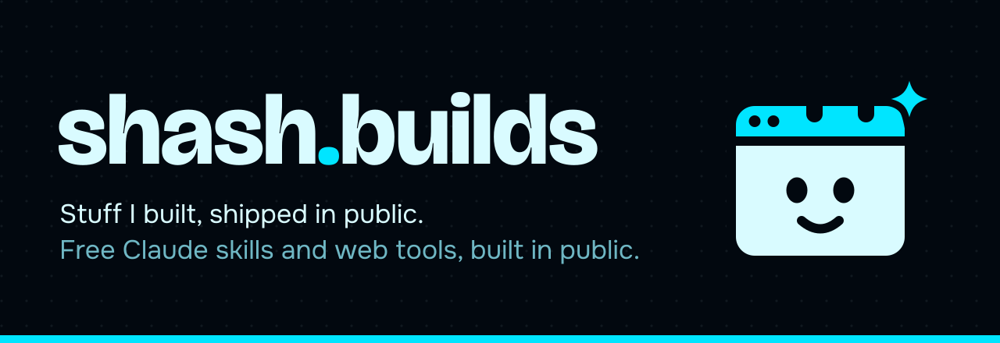

<p align="center">
  
</p>

<p align="center">
  <b>Super Claude, and the other things I've built, shipped in public.</b>
</p>

<p align="center">
  <a href="LICENSE"></a>
  <a href="https://github.com/Shash-Builds/shash.builds/commits"></a>
  <a href="https://github.com/Shash-Builds/shash.builds/stargazers"></a>
  <a href="STATUS.md"></a>
</p>

<p align="center">
  <a href="#super-claude">Super Claude</a> &nbsp;|&nbsp;
  <a href="#things-ive-built">Things I've built</a> &nbsp;|&nbsp;
  <a href="#contact">Contact</a> &nbsp;|&nbsp;
  <a href="STATUS.md">Build log</a>
</p>

---

## Super Claude

**One install that makes Claude work like a sharp operator in every session.** It talks before it acts,
sends grunt work to cheap helpers, checks everything three times, remembers your decisions, and loads one
of 19 powers only when a task needs it. Full guide: [skills/super-mode](skills/super-mode).

**Install (Claude Code):**

```
/plugin marketplace add Shash-Builds/shash.builds
/plugin install super-mode@shashbuilds
```

Start a new session and it loads by itself. On claude.ai, upload `super-mode-skill.zip` from
[Releases](https://github.com/Shash-Builds/shash.builds/releases).

**Easiest: let Claude do it.** Paste this repo's link into Claude and say "set me up". It offers to install
everything and download every tool the powers use, and waits for your yes. Or clone the repo and run
`python3 scripts/setup.py` (it checks first and changes nothing until you add `--yes`).

**Four modes, always on:** talk first, economy (cheap helpers in parallel), careful (three checks before
anything goes out), memory (every decision saved).

**19 powers, loaded on demand:**

| Power | For |
|---|---|
| Video Studio | Reels, explainers, edits, clean voice, captions, music, motion |
| Writer | Posts, emails, scripts, replies that sound like you |
| Social | Content plans, hooks, analytics, "why no views" |
| YouTube | Titles and thumbnails, scripts, retention, Shorts, SEO |
| Clipping | Clipping campaigns and Shorts from long videos |
| Research | Sourced answers, with every fact checked and dated |
| Founder | Testing an idea before money goes in |
| Career | Finding roles, CVs, applications, follow-ups |
| Sales | Leads, site audits, sample pages, cold email |
| Ecom | Listings, product images, fees and margins |
| Amazon Ads | Search terms, negatives, bids, audits |
| Reviewer | Scores, ranked fixes, second opinions |
| Visuals | AI images and video prompts |
| Web | Websites and landing pages |
| Operator | Big multi-day projects, handovers, backups |
| Numbers | Every calculation done in code |
| Docs | Docs, sheets, decks, link lists |
| Helper | Fixing a computer or phone, one step at a time |
| Dashboard | Your own dashboard of goals, work and to-dos, kept current by every session |

## Things I've built

| What | What it is |
|---|---|
| [Super Claude](skills/super-mode) | The one-install operator above |
| [23 Claude skills](skills/README.md) | The specialists Super Claude builds on, each installable on its own |
| [OpenSourceEverything](https://opensourceeverythingin.netlify.app) | Free, ad-free web apps: Arena, OpenPrep, GoodHabit |
| [DayPulse](https://ai.studio/apps/0aa8b1b9-5690-4901-b501-ec6fd8a53544) | Money, gym and news in one app, built live from one spoken prompt in Google AI Studio |
| [NEXUS STRIKE](https://ai.studio/apps/ff06bbe3-a10a-478b-a67f-327c9b230a17) | A multiplayer phone shooter with a thumb-learning aim calibrator, built in Google AI Studio |
| [Growth School Gauntlet](https://claude.ai/artifact/6dy5WafPKHmu7oX218g4FZ) | A 3D creator game that Gemini built through its API |
| [Level-Up Game Dashboard](tools/level-up-dashboard) | Turn a year-long goal into a game: levels, boss fights, quests, XP and streaks |
| [Built in Bed](content/) | A daily log of what I built that day: scripts and posts, one folder per day |

## Contact

<p><a href="mailto:shash.builds@gmail.com,shashwatj05@gmail.com?subject=Hello%20from%20shash.builds"></a></p>

Or write to [shash.builds@gmail.com](mailto:shash.builds@gmail.com) or [shashwatj05@gmail.com](mailto:shashwatj05@gmail.com).

[Instagram](https://www.instagram.com/shash.builds) &nbsp;|&nbsp;
[YouTube](https://www.youtube.com/@shash.builds) &nbsp;|&nbsp;
[X](https://x.com/shashbuilds)

## Contributing

Found a bug, want a skill, or made something better? Read [CONTRIBUTING.md](CONTRIBUTING.md). Be decent: [Code of Conduct](CODE_OF_CONDUCT.md).

## License

- **Code** (skills, tools, templates, scripts): [MIT](LICENSE).
- **Content** (everything in `content/` and `media/`): [CC BY 4.0](LICENSE-CONTENT.md). Credit "shash.builds by Shashwat Jain".
- **Fonts** in the media kit: Bricolage Grotesque and Onest, both SIL Open Font License 1.1. Credits in [media/README.md](media/README.md).
