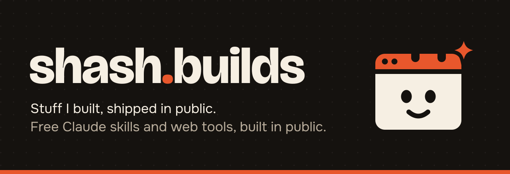
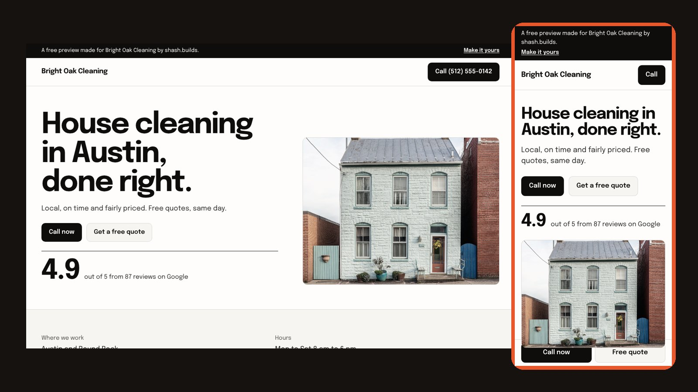

<p align="center">
  
</p>

<p align="center">
  <b>Stuff I built: Claude skills, web tools and websites, shipped in public.</b>
</p>

<p align="center">
  <a href="LICENSE"></a>
  <a href="https://github.com/Shash-Builds/shash.builds/commits"></a>
  <a href="https://github.com/Shash-Builds/shash.builds/stargazers"></a>
  <a href="STATUS.md"></a>
</p>

<p align="center">
  <a href="#quick-start">Quick start</a> &nbsp;|&nbsp;
  <a href="#everything-in-here">Skills and tools</a> &nbsp;|&nbsp;
  <a href="#hire-me">Hire me</a> &nbsp;|&nbsp;
  <a href="STATUS.md">Build log</a> &nbsp;|&nbsp;
  <a href="CONTRIBUTING.md">Contribute</a>
</p>

<p align="center"></p>
<p align="center"><sub>Built from one CSV row with the free <a href="tools/one-page-starter">One-Page Starter</a>. Sample business.</sub></p>

---

## What this is

I'm Shashwat Jain. I build things: a clothing brand, websites, and the AI tools in this repo.

This repo is everything I've built, shipped in the open:

- **22 Claude skills** that do real jobs: a harsh buyer, a humanizer, a head of social media, a motion designer and more.
- **Web tools and templates** you can copy, fork and ship today.
- **8 concept websites**, one per trade, in the [portfolio gallery](https://shash-builds.github.io/Shash.builds/portfolio/).
- **The build log.** What I built, what broke, what's next. Every day.

All of it is free. Take what helps.

## Quick start

Install the skills in under a minute.

**Claude Code**

```
/plugin marketplace add Shash-Builds/shash.builds
/plugin install master@shashbuilds
/plugin install humanizer@shashbuilds
```

Add any other skill the same way, or run `/plugin` and pick from the list. Then just ask:
"review this listing like a harsh buyer", "careful mode on", "make this sound like me".

**Claude.ai (web, desktop or mobile)**

1. Download a skill's `.zip` from [Releases](https://github.com/Shash-Builds/shash.builds/releases).
2. Turn on code execution in Settings, then upload the zip as a custom skill.
3. Ask Claude for the job the skill does.

**Any Claude chat:** paste a skill's prompt from [skills/PROMPTS.md](skills/PROMPTS.md).

**Web tools** are plain HTML, CSS and JavaScript. Open the folder, read its README, deploy it anywhere static.

## Everything in here


### Claude skills

22 free Claude specialists that work together, including a sales kit that finds and pitches clients. Full guide: [skills/README.md](skills/README.md).

| Skill | What it does |
| --- | --- |
| [Master Skill](skills/master) | Routes every task to the right specialists. Runs the video workflow. |
| [Humanizer](skills/humanizer) | Makes writing sound like you, not a model. Every fact kept. |
| [Social Media](skills/social-media) | Your head of social: strategy, posts, hooks, a 100-point check. |
| [LinkedIn](skills/linkedin) | A LinkedIn ghostwriter that never makes up a story. |
| [Motion Design Taste](skills/motion-design-taste) | Scores a video out of 100 like a senior motion designer. |
| [Audio Review](skills/audio-review) | A senior audio designer's review, with a ranked fix list. |
| [Transcriber](skills/transcriber) | Whisper transcripts and timed captions, right in the chat. |
| [Clipper](skills/clipper) | Long videos into captioned vertical clips. Permission first. |
| [AI Visuals](skills/ai-visuals) | Fixes AI images and video for where they will be used. |
| [Harsh Buyer Review](skills/harsh-buyer-review) | A real buyer compares you with 3 to 5 competitors. |
| [Competitor Research](skills/competitor-research) | Sourced, dated, double-checked competitor research. |
| [Niche Research](skills/niche-research) | A content niche into a sourced posting plan and 50 ranked video topics. |
| [Ecom](skills/ecom) | Listings, images and profit per order from your real fees. |
| [AI Resume](skills/ai-resume) | One true page that a recruiter and an ATS can both read. |
| [Brutal Review](skills/brutal-review) | A blunt second opinion from a different AI model. |
| [Comment Drafter](skills/comment-drafter) | Comment drafts for LinkedIn, X or Instagram posts. Never posts. |
| [Careful Mode](skills/careful-mode) | Every piece of work checked three times before you see it. |
| [Economy Mode](skills/economy-mode) | Cheap models for simple work, and a memory sheet. |
| [Lead Finder](skills/lead-finder) | Local businesses by trade and city, audited. |
| [Site Audit](skills/site-audit) | A weak-site score and 3 provable problems. |
| [Mock Builder](skills/mock-builder) | A one-page mock in one file, marked sample. |
| [Cold Email Drafter](skills/cold-email-drafter) | Three short, honest emails. CAN-SPAM ready. |


### Web tools and templates

Plain HTML, CSS and JavaScript. Free hosting, no monthly fees.

| Tool | What it does |
| --- | --- |
| [One-Page Starter](tools/one-page-starter) | A one-page site for a local service business, from one CSV row. Call button, reviews, quote form. |
| [Lead Tracker](tools/lead-tracker) | Every website lead in a Google Sheet, with where it came from, and a Dashboard by source. |
| [Level-Up Game Dashboard](tools/level-up-dashboard) | Turn your 365-day business goal into a game: levels, boss fights, quests, XP, streaks and money against pace. [Try the sample](https://shash-builds.github.io/Shash.builds/docs/level-up-game/#sample). |

What's coming next lives in the backlog in [STATUS.md](STATUS.md). Machines can read the same list in [`catalog.json`](catalog.json) and [`llms.txt`](llms.txt).

## The map

```
skills/      22 Claude skills, each an installable Claude Code plugin
examples/    real outputs from the skills
tests/       the test suite every skill passes
tools/       open-source web tools and one-page site starters
templates/   video, overlay, post and release templates
content/     the daily "Built in Bed" drop: video script, LinkedIn and Instagram posts
media/       banners, icons, Tab, the social preview, and the script that builds them
research/    community maps and platform rules, each with sources and dates
STATUS.md    the public build log
```

## Built in Bed

Every day I post a 2-minute video about what I built that day. The scripts and posts live in [`content/`](content/), one folder per day, so you can see exactly how the sausage gets made.

Meet  **Tab**, the mascot: a browser tab (websites), an AI spark (Claude) and calendar rings (shipped on a schedule).

## Hire me


**One-page website for your service business. $400 flat. Live in 7 days.**

Cleaners, landscapers, painters, contractors, detailers, coaches. If customers find you on Google and call you, you need one clean page that turns that visit into a call.

- See 8 concept sites, one per trade, in the [portfolio gallery](https://shash-builds.github.io/Shash.builds/portfolio/) (source and case cards in [`portfolio/`](portfolio)),
- See the work and the offer on [shashwat-websites.netlify.app](https://shashwat-websites.netlify.app),
- Email [shash.builds@gmail.com](mailto:shash.builds@gmail.com), or
- [Open a hire request](https://github.com/Shash-Builds/shash.builds/issues/new?template=hire.yml) with your business name and current site. Keep phone numbers and emails out of it: issues are public. I'll reply there.

## Follow the build

[Website](https://shashwat-websites.netlify.app) &nbsp;|&nbsp;
[Instagram](https://www.instagram.com/shash.builds) &nbsp;|&nbsp;
[YouTube](https://www.youtube.com/@shash.builds) &nbsp;|&nbsp;
[X](https://x.com/shashbuilds)

Star the repo to get each new drop in your GitHub feed.

## Contributing

Found a bug, want a skill, or made something better? Read [CONTRIBUTING.md](CONTRIBUTING.md). Be decent: [Code of Conduct](CODE_OF_CONDUCT.md).

## License

- **Code** (skills, tools, templates, scripts): [MIT](LICENSE).
- **Content** (everything in `content/` and `media/`): [CC BY 4.0](LICENSE-CONTENT.md). Credit "shash.builds by Shashwat Jain".
- **Fonts** in the media kit: Bricolage Grotesque and Onest, both SIL Open Font License 1.1. Credits in [media/README.md](media/README.md).
