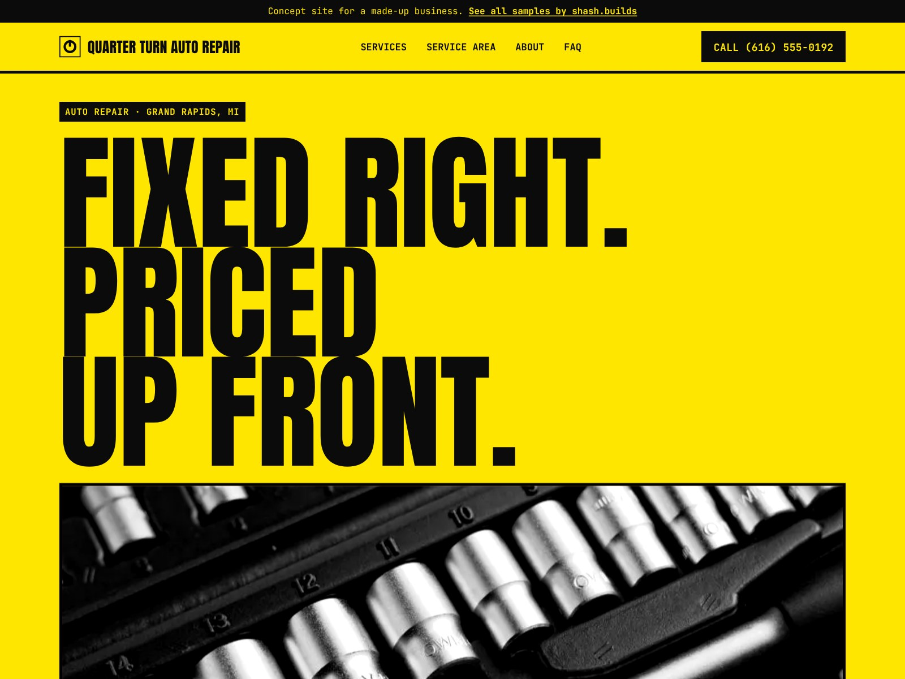

# Quarter Turn Auto Repair (concept work)

**Concept work.** Quarter Turn Auto Repair is a made-up business. The phone number is a 555 number, the prices on the price board are sample numbers and every line of copy is sample content. No reviews, ratings or certifications are claimed.

| | |
| --- | --- |
| Trade | Auto repair |
| Place | Grand Rapids, Michigan |
| Style | S-07 Brutal (from the shash.builds lookbook): Anton and JetBrains Mono, safety yellow, raw black, heavy rules |
| Layout | Poster hero (full-width headline over a photo strip), a price board like the sign over the counter, boxed services |
| Build time | Under an hour on top of the shared generator: copy, photos, price board, style, checks |
| Lighthouse (mobile) | Performance 98, Accessibility 100, Best Practices 100, SEO 100 |
| Live page | [`index.html`](index.html) |

## The problem with most auto repair sites

- People expect to be upsold, and most shop sites do nothing to change that.
- No prices for even the simplest jobs, so drivers call around or go to a chain.
- The phone number is small, and booking means a form that asks for everything.
- Nothing about getting home while the car is in the shop.

## What this design does about it

- The headline is the promise customers care about: "Fixed right. Priced up front."
- A price board right under the hero, with posted prices for oil changes, brakes, diagnosis, tire swaps, batteries and alignments.
- The process explains the photo-and-price text before any work, so nothing gets done without the owner's OK.
- Michigan-specific services: winter prep, tire swaps, rust and pothole damage.
- A loud, honest look that stands out from dealership templates.
- A 12-month or 12,000-mile repair promise instead of fake stars, and an empty "Reviews go here" panel for the shop's real Google reviews.

## Screenshots

| File | Use |
| --- | --- |
| [`shots/desktop-1600x1200.jpg`](shots/desktop-1600x1200.jpg) | Dribbble, Upwork and Contra cover |
| [`shots/mobile-1080x1350.jpg`](shots/mobile-1080x1350.jpg) | Instagram portrait |
| [`shots/desktop-1280x720.jpg`](shots/desktop-1280x720.jpg) | Fiverr cover |
| [`shots/mobile-390x844.png`](shots/mobile-390x844.png) | Phone screen at 2x |
| [`shots/scroll.mp4`](shots/scroll.mp4) | Scroll through the full page |

Photos: Jaroslaw Puszczynski via StockSnap and rawpixel, all CC0. No people in any photo.

Rebuild with `python3 portfolio/build.py auto-repair-mi` and `node portfolio/shots.cjs auto-repair-mi`.
