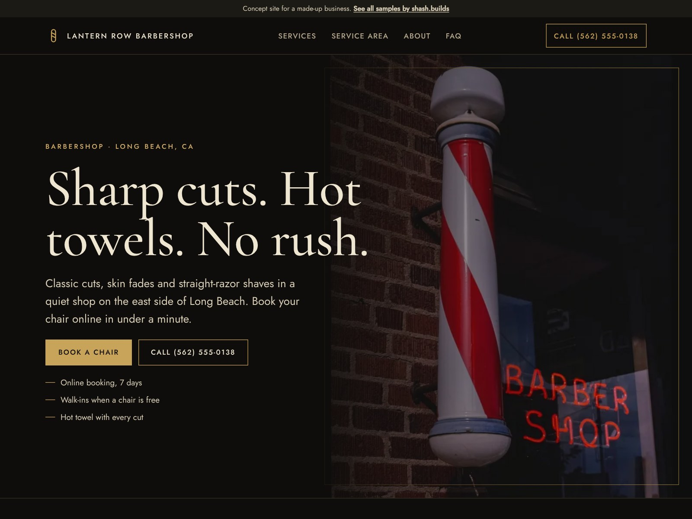

# Lantern Row Barbershop (concept work)

**Concept work.** Lantern Row Barbershop is a made-up business. The phone number is a 555 number, the prices on the menu are sample numbers and every line of copy is sample content. No reviews or ratings are claimed.

| | |
| --- | --- |
| Trade | Barbershop |
| Place | Long Beach, California |
| Style | S-08 Luxe (from the shash.builds lookbook): Cormorant Garamond and Jost, near-black, cream and brushed gold |
| Layout | Full-bleed photo hero with a dark fade, a price menu with dotted leaders, no cards |
| Build time | Under an hour on top of the shared generator: copy, photos, menu, style, checks |
| Lighthouse (mobile) | Performance 100, Accessibility 100, Best Practices 100, SEO 100 |
| Live page | [`index.html`](index.html) |

## The problem with most barbershop sites

- The shop lives on Instagram, and the "website" is a booking widget with no prices or personality.
- Prices are hidden, so people message to ask, or don't come.
- Nobody says whether walk-ins are welcome, how long a cut takes or where to park.
- Shops that feel premium in person look like a template online.

## What this design does about it

- "Book a chair" is the main button, in gold, on the first screen and in the sticky bar on phones.
- The full menu with prices sits right under the hero, laid out like a printed shop menu.
- The FAQ answers walk-ins, timing, textured hair, kids and parking.
- A dark, gold-framed look with a classic serif, so the site feels like the shop.
- A 7-day touch-up promise instead of fake stars, and an empty "Reviews go here" panel for the shop's real Google reviews.

## Screenshots

| File | Use |
| --- | --- |
| [`shots/desktop-1600x1200.jpg`](shots/desktop-1600x1200.jpg) | Dribbble, Upwork and Contra cover |
| [`shots/mobile-1080x1350.jpg`](shots/mobile-1080x1350.jpg) | Instagram portrait |
| [`shots/desktop-1280x720.jpg`](shots/desktop-1280x720.jpg) | Fiverr cover |
| [`shots/mobile-390x844.png`](shots/mobile-390x844.png) | Phone screen at 2x |
| [`shots/scroll.mp4`](shots/scroll.mp4) | Scroll through the full page |

Photos: a barber pole from the Library of Congress (public domain) and a shave kit, both via rawpixel. No people in any photo.

Rebuild with `python3 portfolio/build.py barber-ca` and `node portfolio/shots.cjs barber-ca`.
