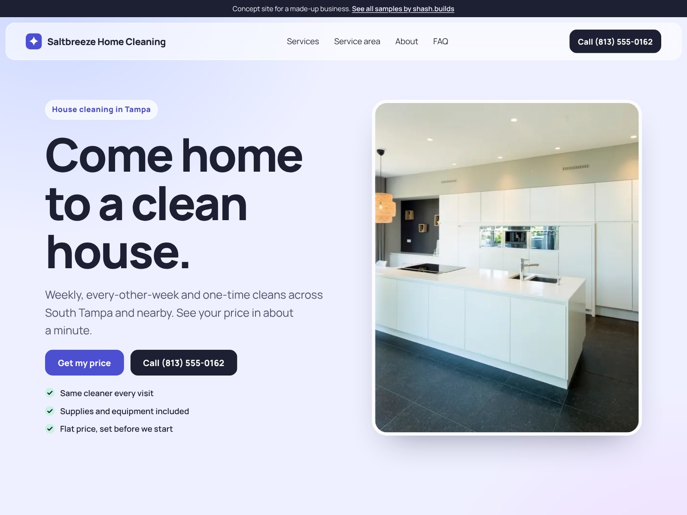

# Saltbreeze Home Cleaning (concept work)

**Concept work.** Saltbreeze Home Cleaning is a made-up business. The phone number is a 555 number, the prices in the price checker are sample numbers and every line of copy is sample content. No reviews or ratings are claimed.

| | |
| --- | --- |
| Trade | House cleaning |
| Place | Tampa, Florida |
| Style | S-05 Glass (from the shash.builds lookbook): Manrope, frosted panels over a blue, lilac and mint wash |
| Build time | Under an hour on top of the shared generator: copy, photos, price checker, style signature, checks |
| Lighthouse (mobile) | Performance 100, Accessibility 100, Best Practices 100, SEO 100 |
| Live page | [`index.html`](index.html) |

## The problem with most house cleaner sites

- "Call for a quote" is the only option, and most people who want a cleaner don't want to call.
- No prices anywhere, so visitors leave to find a company that shows them.
- Services are a long list with no difference between a regular clean and a deep clean.
- Nothing about who actually comes into the house, which is the first worry for most customers.

## What this design does about it

- "Get my price" is the main button, with Call right next to it, and both stay in a sticky bar on phones.
- A price checker: pick bedrooms, bathrooms and how often, and the price per visit updates on the spot. The owner sets the real numbers.
- Six clear services, from recurring cleans to vacation rental turnovers, each in one sentence.
- "Small team, same faces": the about section answers who comes into the house, and the FAQ covers keys, pets, supplies and rescheduling.
- A 24-hour re-clean promise instead of fake stars, and an empty "Reviews go here" panel for the business's real Google reviews.

## Screenshots

| File | Use |
| --- | --- |
| [`shots/desktop-1600x1200.jpg`](shots/desktop-1600x1200.jpg) | Dribbble, Upwork and Contra cover |
| [`shots/mobile-1080x1350.jpg`](shots/mobile-1080x1350.jpg) | Instagram portrait |
| [`shots/desktop-1280x720.jpg`](shots/desktop-1280x720.jpg) | Fiverr cover |
| [`shots/mobile-390x844.png`](shots/mobile-390x844.png) | Phone screen at 2x |
| [`shots/scroll.mp4`](shots/scroll.mp4) | Scroll through the full page |

Photos: rawpixel (two kitchens) and Kristin Hardwick via StockSnap, all CC0. No people in any photo.

Rebuild with `python3 portfolio/build.py cleaner-fl` and `node portfolio/shots.cjs cleaner-fl`.
