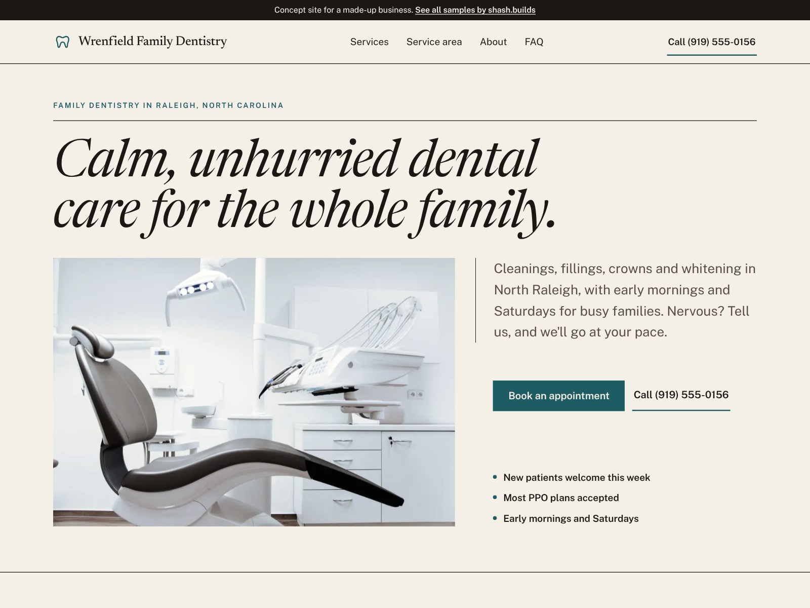

# Wrenfield Family Dentistry (concept work)

**Concept work.** Wrenfield Family Dentistry is a made-up practice. The phone number is a 555 number and every line of copy is sample content. No reviews, ratings, credentials or awards are claimed.

| | |
| --- | --- |
| Trade | Family dentist |
| Place | Raleigh, North Carolina |
| Style | S-06 Editorial (from the shash.builds lookbook): Newsreader italic and Public Sans, warm paper, ink rules, deep teal |
| Layout | Magazine-grid hero, services as ruled print columns, a numbered first-visit strip, a drop cap |
| Build time | Under an hour on top of the shared generator: copy, photos, style, checks |
| Lighthouse (mobile) | Performance 100, Accessibility 100, Best Practices 100, SEO 100 |
| Live page | [`index.html`](index.html) |

## The problem with most dentist sites

- Cold, clinical pages full of stock smiles that don't help a nervous patient feel any better.
- The booking button competes with insurance logos, blog links and special offers.
- No straight answer on the two questions people ask first: do you take my insurance, and what if I'm scared?
- New patients have no idea what the first visit involves or what it will cost.

## What this design does about it

- A calm, editorial look with a warm serif, so it feels like a quiet practice, not a clinic.
- "Book an appointment" is the main button on the first screen and in a sticky bar on phones, with Call right next to it.
- A first-visit strip in three steps: a real conversation, a gentle exam, a written plan with prices.
- The FAQ answers insurance, nerves, kids' first visits, emergencies and paying without insurance.
- A "no surprise bills" promise instead of fake stars, and an empty "Reviews go here" panel for the practice's real Google reviews.

## Screenshots

| File | Use |
| --- | --- |
| [`shots/desktop-1600x1200.jpg`](shots/desktop-1600x1200.jpg) | Dribbble, Upwork and Contra cover |
| [`shots/mobile-1080x1350.jpg`](shots/mobile-1080x1350.jpg) | Instagram portrait |
| [`shots/desktop-1280x720.jpg`](shots/desktop-1280x720.jpg) | Fiverr cover |
| [`shots/mobile-390x844.png`](shots/mobile-390x844.png) | Phone screen at 2x |
| [`shots/scroll.mp4`](shots/scroll.mp4) | Scroll through the full page |

Photos: Daniel Frank via StockSnap and rawpixel, all CC0. No people in any photo.

Rebuild with `python3 portfolio/build.py dentist-nc` and `node portfolio/shots.cjs dentist-nc`.
