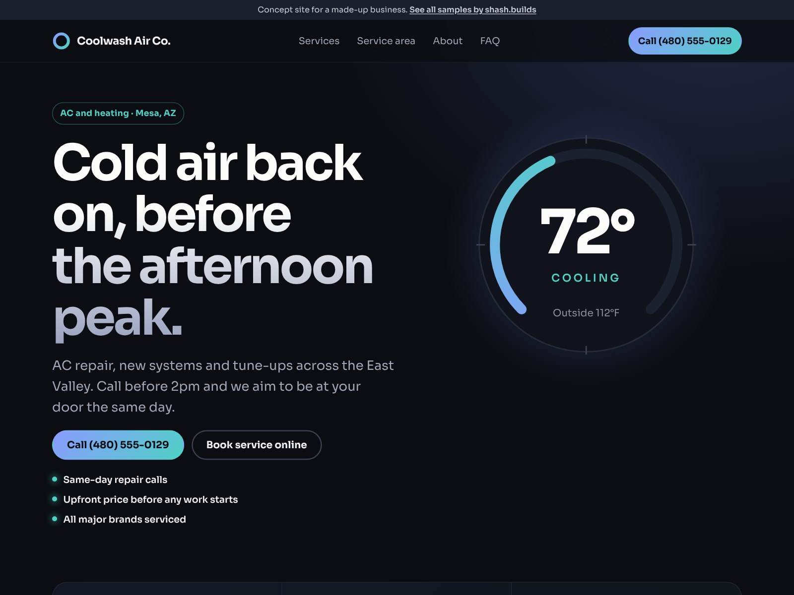

# Coolwash Air Co. (concept work)

**Concept work.** Coolwash Air Co. is a made-up business. The phone number is a 555 number and every line of copy is sample content. No reviews, ratings or licenses are claimed.

| | |
| --- | --- |
| Trade | AC and heating (HVAC) |
| Place | Mesa, Arizona |
| Style | S-02 Night glow (from the shash.builds lookbook): Sora, dark ink with a periwinkle-to-teal glow |
| Layout | Illustrated thermostat hero, stats band, bento services grid, glowing step timeline |
| Build time | Under an hour on top of the shared generator: copy, dial illustration, style, checks |
| Lighthouse (mobile) | Performance 100, Accessibility 100, Best Practices 100, SEO 100 |
| Live page | [`index.html`](index.html) |

## The problem with most HVAC sites

- When the AC dies at 3pm in July, people want to know one thing: can you come today? Most sites bury that under coupons and brand logos.
- Pages lead with generic photos of smiling techs, so every company looks the same.
- Prices and fees are a mystery until the truck shows up.
- "Repair or replace?" is the biggest question, and almost nobody answers it.

## What this design does about it

- The headline answers the real question ("Cold air back on, before the afternoon peak") with a same-day promise right under it, and a Call button that stays on screen on phones.
- A stats band straight after the hero: same-day repair visits, a free second opinion, tune-ups twice a year.
- An illustrated thermostat instead of stock photos, so the page looks like no other HVAC site in town.
- The FAQ answers repair or replace with a simple rule, and says the diagnostic fee is waived if you go ahead.
- A 12-month repair promise instead of fake stars, and an empty "Reviews go here" panel for the business's real Google reviews.

## Screenshots

| File | Use |
| --- | --- |
| [`shots/desktop-1600x1200.jpg`](shots/desktop-1600x1200.jpg) | Dribbble, Upwork and Contra cover |
| [`shots/mobile-1080x1350.jpg`](shots/mobile-1080x1350.jpg) | Instagram portrait |
| [`shots/desktop-1280x720.jpg`](shots/desktop-1280x720.jpg) | Fiverr cover |
| [`shots/mobile-390x844.png`](shots/mobile-390x844.png) | Phone screen at 2x |
| [`shots/scroll.mp4`](shots/scroll.mp4) | Scroll through the full page |

Photos: rawpixel and Chelsea Bock via StockSnap, both CC0, no people. The thermostat dial is an SVG drawn for this page.

Rebuild with `python3 portfolio/build.py hvac-az` and `node portfolio/shots.cjs hvac-az`.
