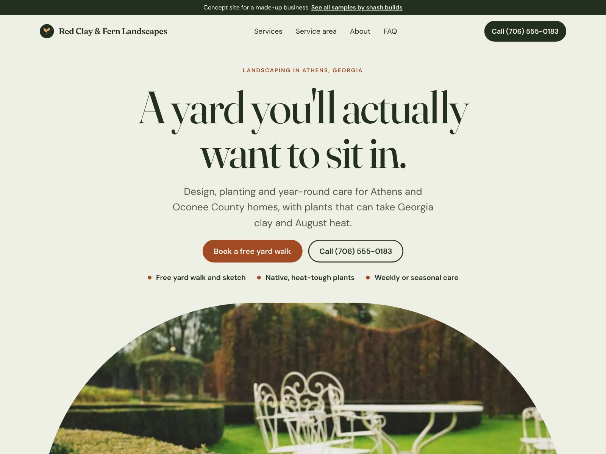

# Red Clay & Fern Landscapes (concept work)

**Concept work.** Red Clay & Fern Landscapes is a made-up business. The phone number is a 555 number and every line of copy is sample content. No reviews, ratings or licenses are claimed.

| | |
| --- | --- |
| Trade | Landscaping |
| Place | Athens, Georgia |
| Style | S-03 Organic (from the shash.builds lookbook): Fraunces and DM Sans, sage paper, deep green, red-clay terracotta |
| Layout | Centred serif hero over an arch photo, two-column service list, four-season strip, arched gallery |
| Build time | Under an hour on top of the shared generator: copy, photos, style, checks |
| Lighthouse (mobile) | Performance 100, Accessibility 100, Best Practices 100, SEO 100 |
| Live page | [`index.html`](index.html) |

## The problem with most landscaper sites

- A slideshow of yards from somewhere else, and no sense of what the company does month to month.
- "Contact us for a quote" with no idea what happens next or what it costs to start.
- Nothing about local conditions, even though clay soil and summer heat decide what survives.
- Mowing, design and drainage all crammed into one list, so a homeowner can't tell what to ask for.

## What this design does about it

- One clear first step: "Book a free yard walk", with the phone right next to it and in a sticky bar on phones.
- A four-season strip that shows what the crew does in spring, summer, fall and winter, which is how homeowners actually think about their yard.
- Copy that talks about Athens red clay and August heat, and an FAQ on clay soil, drainage and when to plant.
- A calm serif look with an arch-shaped hero photo, so it reads like a garden, not a lawn-mowing flyer.
- A one-year plant guarantee instead of fake stars, and an empty "Reviews go here" panel for the business's real Google reviews.

## Screenshots

| File | Use |
| --- | --- |
| [`shots/desktop-1600x1200.jpg`](shots/desktop-1600x1200.jpg) | Dribbble, Upwork and Contra cover |
| [`shots/mobile-1080x1350.jpg`](shots/mobile-1080x1350.jpg) | Instagram portrait |
| [`shots/desktop-1280x720.jpg`](shots/desktop-1280x720.jpg) | Fiverr cover |
| [`shots/mobile-390x844.png`](shots/mobile-390x844.png) | Phone screen at 2x |
| [`shots/scroll.mp4`](shots/scroll.mp4) | Scroll through the full page |

Photos: Daria Nepriakhina, Neslihan Gunaydin and Gaetano Cessati via StockSnap, all CC0. No people in any photo.

Rebuild with `python3 portfolio/build.py landscaper-ga` and `node portfolio/shots.cjs landscaper-ga`.
