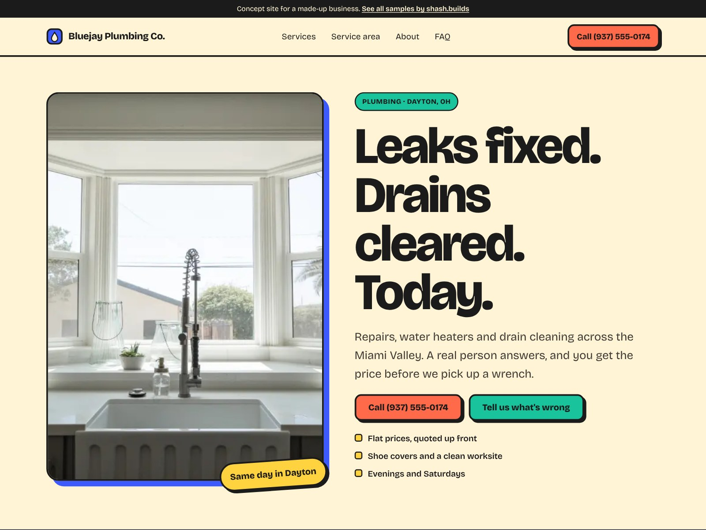

# Bluejay Plumbing Co. (concept work)

**Concept work.** Bluejay Plumbing Co. is a made-up business. The phone number is a 555 number and every line of copy is sample content. No reviews, ratings or licenses are claimed.

| | |
| --- | --- |
| Trade | Plumbing |
| Place | Dayton, Ohio |
| Style | S-04 Playful blocks (from the shash.builds lookbook): Bricolage Grotesque, butter yellow, coral, cobalt and mint, hard shadows |
| Layout | Photo-left hero with a sticker, a "What's going on?" problem picker, colored block services |
| Build time | Under an hour on top of the shared generator: copy, photos, picker, style, checks |
| Lighthouse (mobile) | Performance 100, Accessibility 100, Best Practices 100, SEO 100 |
| Live page | [`index.html`](index.html) |

## The problem with most plumber sites

- Someone with water on the floor has to read a wall of text to find the phone number.
- Nobody says what it costs, so people assume the worst or call three companies.
- The contact form asks "How can we help?" and leaves the stressed homeowner to describe the problem from scratch.
- Every plumber site looks the same: blue, a wrench logo and a stock photo of a man under a sink.

## What this design does about it

- A three-word promise in huge type ("Leaks fixed. Drains cleared. Today.") with Call and Tell us what's wrong side by side, and a sticky bar on phones.
- A "What's going on?" picker: tap Leak, Clog, No hot water and the rest, and it fills in the form and jumps to it.
- Flat prices front and center: in the facts, the steps, the promise and the FAQ.
- Ohio-specific services and answers, like sump pumps and battery backups before the spring rains.
- A bright, friendly look that nobody will confuse with the plumber down the street.
- A flat-price promise instead of fake stars, and an empty "Reviews go here" panel for the business's real Google reviews.

## Screenshots

| File | Use |
| --- | --- |
| [`shots/desktop-1600x1200.jpg`](shots/desktop-1600x1200.jpg) | Dribbble, Upwork and Contra cover |
| [`shots/mobile-1080x1350.jpg`](shots/mobile-1080x1350.jpg) | Instagram portrait |
| [`shots/desktop-1280x720.jpg`](shots/desktop-1280x720.jpg) | Fiverr cover |
| [`shots/mobile-390x844.png`](shots/mobile-390x844.png) | Phone screen at 2x |
| [`shots/scroll.mp4`](shots/scroll.mp4) | Scroll through the full page |

Photos: Matt Bango, Tim Sullivan and Fernando Arcos via StockSnap, all CC0. No people in any photo.

Rebuild with `python3 portfolio/build.py plumber-oh` and `node portfolio/shots.cjs plumber-oh`.
