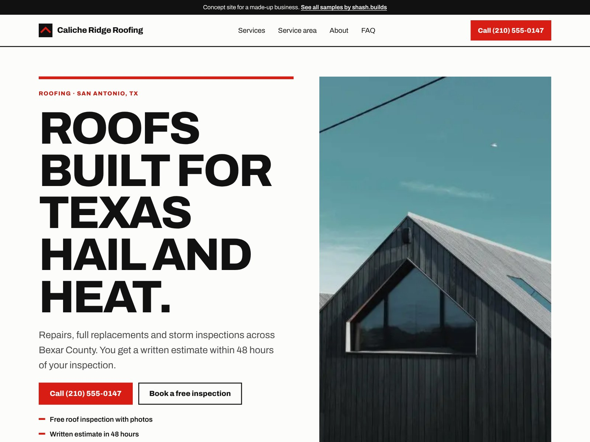

# Caliche Ridge Roofing (concept work)

**Concept work.** Caliche Ridge Roofing is a made-up business. The phone number is a 555 number and every line of copy is sample content. No reviews, ratings or licenses are claimed.

| | |
| --- | --- |
| Trade | Roofing |
| Place | San Antonio, Texas |
| Style | S-01 Swiss grid (from the shash.builds lookbook): Archivo, signal red on paper, hard black rules |
| Build time | Under an hour on top of the shared generator: copy, photos, style signature, checks |
| Lighthouse (mobile) | Performance 100, Accessibility 100, Best Practices 100, SEO 100 |
| Live page | [`index.html`](index.html) |

## The problem with most roofer sites

- The phone number hides in a header that shrinks to a hamburger menu on phones.
- Storm season pages read like a sales pitch, with countdown banners and pop-ups, so homeowners can't tell a local crew from a storm chaser.
- Nothing explains what happens after you call: who inspects, what you get, how insurance fits in.
- Service area is a vague "and surrounding areas" line, so people in the suburbs aren't sure you come to them.

## What this design does about it

- A red Call button in the header and a sticky Call now / Free inspection bar on every phone screen.
- One promise in the headline ("Roofs built for Texas hail and heat") and three plain facts under it: free inspection with photos, written estimate in 48 hours, shingle, metal and tile.
- A three-step process (inspection, written estimate, build and clean up) and an FAQ that answers the insurance question first.
- Service area as named towns, so a homeowner in Boerne or Schertz sees their town on the page.
- A written workmanship promise instead of fake stars, and an empty "Reviews go here" panel for the business's real Google reviews.

## Screenshots

| File | Use |
| --- | --- |
| [`shots/desktop-1600x1200.jpg`](shots/desktop-1600x1200.jpg) | Dribbble, Upwork and Contra cover |
| [`shots/mobile-1080x1350.jpg`](shots/mobile-1080x1350.jpg) | Instagram portrait |
| [`shots/desktop-1280x720.jpg`](shots/desktop-1280x720.jpg) | Fiverr cover |
| [`shots/mobile-390x844.png`](shots/mobile-390x844.png) | Phone screen at 2x |
| [`shots/scroll.mp4`](shots/scroll.mp4) | Scroll through the full page |

Photos: Oliur Rahman, Megan Branson and Bernard Spragg via StockSnap, all CC0. No people in any photo.

Rebuild with `python3 portfolio/build.py roofer-tx` and `node portfolio/shots.cjs roofer-tx`.
