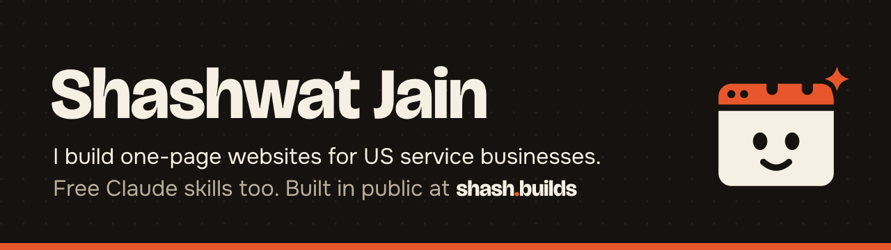

<!-- Profile README for github.com/Shash-Builds. Copy into the repo named Shash-Builds/Shash-Builds.
     Image paths point at the shash.builds repo so the banner has one source. -->

  

### Hi, I'm Shashwat.

I'm a web designer in India working US hours, 8:30 am to 6:30 pm ET. I build **one-page websites for US service businesses: $400 flat, live in 7 days.** I also make free Claude skills and web tools, and I build all of it in public.

### What's shipped

Everything lives in **[shash.builds](https://github.com/Shash-Builds/shash.builds)**. The live list of skills and tools is in its README, and the daily log is in [STATUS.md](https://github.com/Shash-Builds/shash.builds/blob/main/STATUS.md).

### What's next

A new free skill or tool every 1 to 2 days, and a 2-minute "Built in Bed" video every day about what got built.

### Hire me

Cleaner, landscaper, painter, contractor, detailer? You get one clean page that turns Google visitors into calls. $400 flat, live in 7 days.

Email [shash.builds@gmail.com](mailto:shash.builds@gmail.com), [message me on LinkedIn](https://www.linkedin.com/in/shashbuilds) or [open a hire request](https://github.com/Shash-Builds/shash.builds/issues/new?template=hire.yml).

### Follow the build

[Instagram](https://www.instagram.com/shash.builds) &nbsp;|&nbsp; [YouTube](https://www.youtube.com/@shash.builds) &nbsp;|&nbsp; [LinkedIn](https://www.linkedin.com/in/shashbuilds) &nbsp;|&nbsp; [X](https://x.com/shashbuilds)
