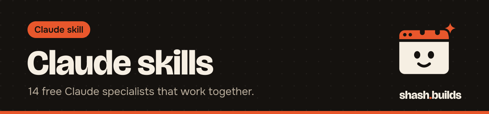

<p align="center"></p>

# Claude skills

19 free Claude specialists: a sales kit that finds and pitches clients, a harsh buyer, a head of social media, a LinkedIn ghostwriter,
a motion designer, an audio engineer, a humanizer and more. Each one does one real job, and
they work together through the Master Skill.

They run in **Claude Code**, on **claude.ai** (web, desktop and mobile) and in **any Claude
chat** as a paste-in prompt.

## The skills

| Skill | What you get | Use it when |
| --- | --- | --- |
| [Master Skill](master) | Hands each task to one of five heads (Product, Ecom, Marketing, Design, Review) that call only the skills that task needs. Videos run the full workflow: plan, build, review as a buyer and a motion designer, check the sound, fix and re-render until the video scores 85 out of 100 | Always on. Install it with the others |
| [Humanizer](humanizer) | Rewrites posts, listings, emails, scripts and replies to sound like you. Flags machine phrasing line by line, follows a guide per channel, checks no fact or price changed | Before anything goes public |
| [Social Media](social-media) | Strategy, calendars, posts, hooks, carousels and reel scripts for Instagram, TikTok, YouTube, LinkedIn and X. Every post passes a 100-point scorecard first | Planning, writing or reviewing social content |
| [LinkedIn](linkedin) | Finds the post only you could write, writes a hook that works before "see more", edits every draft through the Humanizer. Also headline, About, comments and messages | Anything on LinkedIn |
| [Motion Design Taste](motion-design-taste) | A senior motion designer's review: a score out of 100, ranking against references, exact fixes, applied when Claude has the source | Before you ship any video |
| [Audio Review](audio-review) | A senior audio designer's review: score, ranked problems with timestamps, a fix list, loudness checks for Spotify, YouTube, podcasts and ads | Before you publish audio |
| [Transcriber](transcriber) | Transcribes voice notes, podcasts, calls and videos with OpenAI's Whisper inside the chat: text and timestamped captions in 90+ languages | Captions, edits, chapters, posts |
| [Clipper](clipper) | Turns long videos into vertical Shorts and Reels with word-by-word captions and a hook line. Only clips videos you have permission to use | Shorts from your own long videos |
| [AI Visuals](ai-visuals) | Reviews an AI image or video for where it will be used, scores it and gives the exact fixed prompt or edit | When an AI visual isn't quite right |
| [Harsh Buyer Review](harsh-buyer-review) | A real buyer researches 3 to 5 competitors, compares one-on-one, and says exactly why they would or wouldn't buy | Before you launch or change a listing, page or price |
| [Competitor Research](competitor-research) | Sourced, dated competitor research on marketplaces, websites, social media and ads, double-checked, run by cheap Haiku helpers | Before you price, launch or ask for feedback |
| [Niche Research](niche-research) | Researches a content niche into a posting plan: top accounts, best posts of the last 90 days and why, audience questions, gaps, 50 ranked video topics with hooks, posting times in ET. Every row sourced and dated, run by Haiku helpers | Before you plan a month of content |
| [Ecom](ecom) | An e-commerce operator for Amazon, Walmart, Etsy, Shopify, Flipkart and more: listings, images, profit per order from your real fees, ads, returns, stock | Anything about selling online |
| [Lead Finder](lead-finder) | Finds US service businesses by trade and city from OpenStreetMap (or Google Places with your key), audits each site, writes a private CSV ranked weakest first | Prospecting for web design clients |
| [Site Audit](site-audit) | A weak-site score from 0 to 100 and the 3 most specific, provable problems, in words an owner understands. Reads robots.txt, fetches one page | Before a pitch, or to check your own site |
| [Mock Builder](mock-builder) | A one-page website mock in one HTML file, every placeholder marked as sample, with a shareable preview path | Showing a prospect instead of telling |
| [Cold Email Drafter](cold-email-drafter) | A 3-email sequence (90 words or fewer, then day 3 and day 7) from the audit and the mock, with CAN-SPAM basics and a checker | First contact with a business |
| [Careful Mode](careful-mode) | Checks every piece of work three times (is it right, is it complete, how could it go wrong) before handing it over | Prices, contracts, customer emails, launches |
| [Economy Mode](economy-mode) | Sends simple work to cheaper models and keeps the strongest one for decisions. Keeps a memory sheet so Claude remembers across sessions | Long Claude Code sessions |

## The sales kit

Four skills that work as one pipeline for anyone selling websites to local businesses:

```
lead-finder  ->  site-audit  ->  mock-builder  ->  cold-email-drafter
(who)            (what's weak)    (show them)       (ask, honestly)
```

The Master Skill's Sales head runs them in order. Lead lists stay private: save them under `leads/` or as `*.leads.csv`, which git ignores here.

## Install

### Option 1: Claude Code (recommended, every skill works fully)

Add the catalog once:

```
/plugin marketplace add Shash-Builds/shash.builds
```

Then install the skills you want:

```
/plugin install master@shashbuilds
/plugin install humanizer@shashbuilds
/plugin install social-media@shashbuilds
/plugin install linkedin@shashbuilds
/plugin install motion-design-taste@shashbuilds
/plugin install audio-review@shashbuilds
/plugin install transcriber@shashbuilds
/plugin install clipper@shashbuilds
/plugin install ai-visuals@shashbuilds
/plugin install harsh-buyer-review@shashbuilds
/plugin install competitor-research@shashbuilds
/plugin install niche-research@shashbuilds
/plugin install ecom@shashbuilds
/plugin install careful-mode@shashbuilds
/plugin install economy-mode@shashbuilds
/plugin install lead-finder@shashbuilds
/plugin install site-audit@shashbuilds
/plugin install mock-builder@shashbuilds
/plugin install cold-email-drafter@shashbuilds
```

Or run `/plugin` and pick from the list. Then ask naturally: "review this listing like a
harsh buyer", "careful mode on", "how does this audio sound?". Updates:
`/plugin marketplace update shashbuilds`, or turn on auto-update under Marketplaces in `/plugin`.

**Master is on in every session.** It loads a compact router of a few hundred tokens, so a
quick question gets no tools and a video or a listing gets the right specialist. To have it
step in only for video, audio, social, feedback and research, run
`/plugin configure master@shashbuilds` and pick task-specific.

**Requirements.** Audio Review and Motion Design Taste need [ffmpeg](https://ffmpeg.org/download.html)
and Python 3 (Audio Review also needs `numpy`). The Master Skill renders video with
[Node.js](https://nodejs.org), Playwright and Chromium. Harsh Buyer Review and Competitor
Research need web search, which Claude Code has built in.

### Option 2: claude.ai, Claude Desktop or Claude Mobile

1. Download the skill's zip from the latest [Release](https://github.com/Shash-Builds/shash.builds/releases).
2. In Claude's settings, turn on code execution, then upload the zip as a custom skill.
3. Start a chat and ask for the job. Upload the Master Skill with the others: it uses them.

### Option 3: Any Claude chat, no setup

Copy the skill's prompt and paste it as your first message, or into a Claude Project's
instructions. Every prompt is listed in [PROMPTS.md](PROMPTS.md). The Master Skill with every
skill in one file is [`dist/master-full.md`](../dist/master-full.md).

## Use fewer credits

- **Keep Master on.** It costs a few hundred tokens and stops Claude loading skills a task doesn't need.
- **Install only what you use.** Every installed skill adds its short description to every session.
- **Start fresh for a new task.** `/clear` when you switch topics, `/compact` in long sessions.
- **Let Claude remember.** With Economy Mode, "remember this" writes to `memory/memory.csv` in your project, so nothing is re-explained after `/clear`.

## What happens to your files

In Claude Code the audio and video skills measure your files on your own computer with
ffmpeg; Claude sees the measurements and stills, not the raw file. On claude.ai, uploads are
handled under your plan's normal terms. Nothing is sent to shash.builds.

## Real outputs

- [An Ecom profit run](../examples/ecom-unit-economics): a price change worked out in code from real fees.

## Add or change a skill

[`CLAUDE.md`](../CLAUDE.md) has the checklist, and Claude Code follows it when you ask it to
add a skill. Run `python3 tests/run_tests.py` before you push.

MIT licensed, copyright Shashwat Jain. Every skill folder and zip carries the license.
