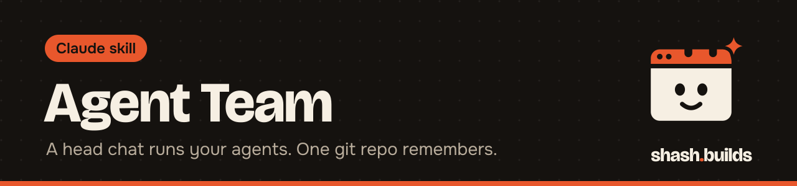

<p align="center"></p>

# Agent Team

**Turn one Claude chat into the head of a small team. The head plans your day, gives each specialist agent its job, reviews everything hard and briefs you in plain words. Every agent has its own folder, git branch, skill playbook and inbox in one private repo, so no work is ever lost.**

## What it looks like

Example (a made-up founder and team):

```
Head chat, 7:00 AM briefing
  Done yesterday: 3 reels drafted, 18 of 20 outreach messages sent, 15 comments.
  Waiting on you: approve reel 2, answer the pricing question from Sales.
  Today: Scheduler has the checklist ready. Nothing goes out without your okay.

private repo
  agents/2-top-funnel/    AGENT.md  skills.md  notes.md  work/   (branch agent/2-top-funnel)
  agents/6-scheduler/     ...
  updates/inbox/1-head/   2026-11-06_1430_from-6-scheduler.md
  updates/status/         one line per agent, newest first
  daily/2026-11-07.md     the day's checklist, ticked with proof
```

## How it works

1. **You describe the team once:** the roles (or take the default 8: head, three content agents, comments, scheduler, a revenue role, a personal goal), your daily checklist and a private repo.
2. **The head builds the repo:** one folder and one branch per agent, a shared memory sheet, an inbox for every agent and a status board.
3. **Each agent trains once:** it studies its skills, writes its own best-of playbook with sources, practises on drafts and reports what it needs. After that it adds one line to its playbook every day.
4. **The head runs the day:** a briefing at your time, a hard review of every piece, and only approved work merged into `main`.

Agents talk only through the inboxes, and only along the lines you set (for example, content agents talk only to the scheduler). They never post, send, log in or pay. You press send.

## Install in 3 steps

1. `/plugin marketplace add Shash-Builds/shash.builds`
2. `/plugin install agent-team@shashbuilds`
3. Ask: "Set up my agent team." Have a private GitHub repo ready.

Any chat: paste [the SKILL.md](skills/agent-team/SKILL.md) and [the templates](skills/agent-team/templates.md).

## Good to know

- **Cost:** every agent is its own chat, so a team of 8 uses a lot of a Claude plan. Start with 3 and add more when the work needs them.
- **Starting agents:** in Claude Code on the web the head can start each agent's session itself. Elsewhere it gives you one prompt per agent to paste into a new chat.
- **Privacy:** use a private repo. It will hold names, plans and drafts.
- Works best with [Economy Mode](../economy-mode) (cheap helpers and the memory sheet), [Careful Mode](../careful-mode) and the [Humanizer](../humanizer).

## License

MIT. See [LICENSE.md](LICENSE.md).
