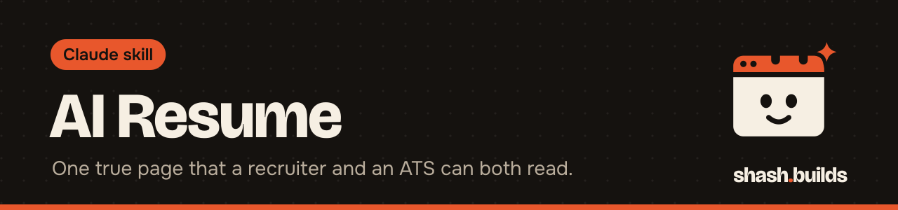
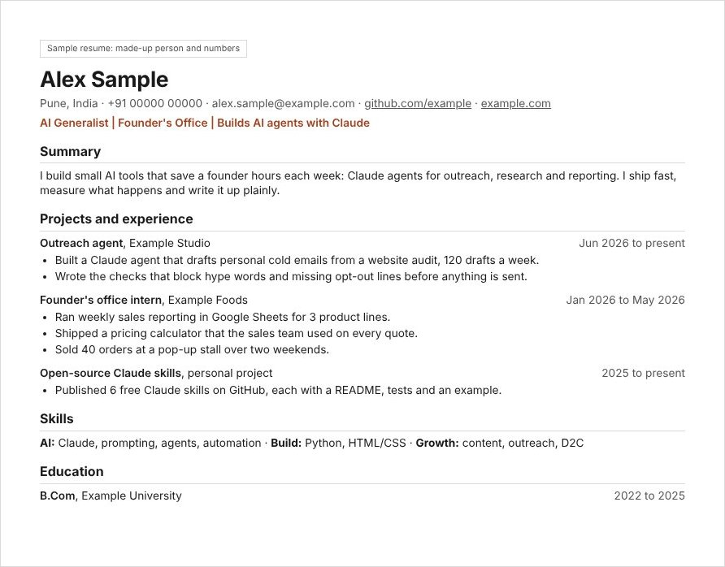

<p align="center"></p>

# AI Resume

**Builds a true, one-page, ATS-safe resume (HTML and PDF) for the role you want, then checks the design and the wording. If a fact is missing, it tells you instead of making one up.**

## What it looks like

<p align="center"></p>

Sample only: a made-up person, employers and numbers. Files: [`examples/sample-resume.html`](examples/sample-resume.html) and [`examples/Alex-Sample-Resume.pdf`](examples/Alex-Sample-Resume.pdf).

You also get, in Claude's reply:

```
Hallmark checks: 6/6 pass (no template tells, clear hierarchy, one spacing scale,
links work in the PDF, nothing cut off, clean copy-paste order)
Missing facts: graduation month; team size on the internship
Headline: AI Generalist | Founder's Office | Builds AI agents with Claude
Summary: (3 lines to paste into job portals)
```

## Install in 3 steps

1. `/plugin marketplace add Shash-Builds/shash.builds`
2. `/plugin install ai-resume@shashbuilds`
3. Ask: "Make my resume for a founder's office role" and point Claude at your profile text or project files.

On claude.ai: download `ai-resume-skill.zip` from [Releases](https://github.com/Shash-Builds/shash.builds/releases) and upload it under Settings, Capabilities. Any chat: paste [the SKILL.md](skills/ai-resume/SKILL.md).

## Before and after

| Without the skill | With the skill |
| --- | --- |
| Two pages, a sidebar, skill bars and "results-driven" | One column, one page, plain verbs, real numbers only |
| Numbers that sound good ("increased sales 300%") | Only numbers you can back up; anything unknown goes on a "Missing facts" list |
| A PDF an ATS reads out of order | Real text, no layout tables, a copy-paste reading-order check |

## Examples

**Ask:** "Update my CV for an AI generalist role." **You get:** `resume.html`, `<Name>-Resume.pdf`, the checklist and the missing facts.

**Ask:** "Turn my Naukri profile into a one-page resume." **You get:** the same, with bullets rewritten as action, tool and result.

## Requirements

A browser that can print to PDF from the command line. The skill uses Edge:

```
msedge --headless --disable-gpu --no-pdf-header-footer --print-to-pdf=out.pdf file:///path/resume.html
```

No Edge? Chrome or Chromium take the same flags:

```
google-chrome --headless --disable-gpu --no-pdf-header-footer --print-to-pdf=out.pdf file:///path/resume.html
```

## FAQ

**Will it make up experience to fill the page?** No. It leaves the line out and lists the gap, so you can add the real fact.

**Why one page?** Recruiters skim, and one page forces the strongest lines to the top.

**Does it work for any role?** Yes. The headline and the order of projects follow the role you name.

## Changelog

- **1.0.0** (2026-11-04): first release in shash.builds.

---

Made by [shash.builds](../../README.md). Need a one-page website for your service business? [$400 flat, live in 7 days](../../README.md#hire-me).

MIT licensed, copyright Shashwat Jain. See [LICENSE.md](LICENSE.md).
