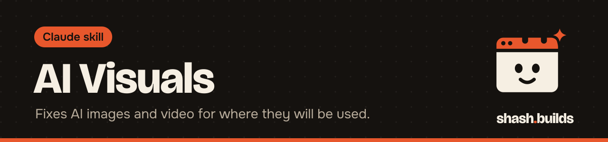

<p align="center"></p>

# AI Visuals

**An art director for AI-made images and video: it reviews your result for where it will be used, scores it, and hands back the exact fixed prompt or edit with every change explained.**

## What it looks like

Example:

```
You: [shares an image] Made this in Midjourney for an Amazon main image. Prompt below. What's wrong?

Claude:
Verdict: 71/100, not ready. Biggest problem: the product has a second, invented zipper.

What's wrong
1. Zipper: the bag has two pulls, your product has one. Cause: the prompt never says "single zipper".
2. Background: soft grey gradient, but the placement needs pure white.

The fix (complete prompt, paste as is)
[full corrected prompt and settings]

What changed in the prompt and why
+ "single center zipper"  fixes 1
~ "studio gradient" -> "pure white background"  fixes 2

Check in the next result: one zipper pull, white edges with no grey halo.
```

The score uses eight weighted criteria, and the total is added up by a script. Your image and prompt decide the real content.

## Install in 3 steps

1. `/plugin marketplace add Shash-Builds/shash.builds`
2. `/plugin install ai-visuals@shashbuilds`
3. Share an image or video, the prompt you used, and say where it will go: "Review this for an Instagram ad."

On claude.ai: download `ai-visuals-skill.zip` from [Releases](https://github.com/Shash-Builds/shash.builds/releases) and upload it under Settings, Capabilities. Any chat: paste [the prompt](skills/ai-visuals/ai-visuals.md), plus the placement's section of [purposes.md](skills/ai-visuals/purposes.md) and the tool's section of [generators.md](skills/ai-visuals/generators.md).

## Before and after

| Without the skill | With the skill |
| --- | --- |
| "Looks good, maybe make the lighting warmer" | A score out of 100 against the placement, with each problem named, where it is and why it happened |
| A rewritten prompt with no explanation of what changed | The complete corrected prompt plus a script-made list of every word removed, added or moved, each tied to one problem |
| Hands, text and logos get a quick glance | They are checked on purpose, since those are the usual AI mistakes |
| You guess whether it is ready | A fixed ready rule: 85 or above, no criterion below 7, and truthfulness and platform rules at 10 |

## Examples

**Ask:** "Is this AI product photo okay for my Etsy listing?"
**You get:** A scored review for the e-commerce placement, covering whether the product looks like what the buyer will receive, plus the exact fix.

**Ask:** "My ChatGPT image keeps adding wrong text to the poster. Fix the prompt."
**You get:** The full corrected prompt, the changed words listed, and a note if exact text is something that tool cannot do reliably, with a different route.

**Ask:** "Review this Runway clip for a YouTube Short."
**You get:** A check of the video for motion, consistency and artifacts, with a fix for the prompt. If it is an edited video with sound, Claude hands over to the `motion-design-taste` skill.

**Ask:** "Generate three versions of this prompt and pick the best." (needs your OpenAI key)
**You get:** Claude asks about the cost first, generates with your key, then reviews and scores each result.

## Requirements

- Nothing for reviewing. It works in any Claude chat.
- Optional generation: Python 3 and an `OPENAI_API_KEY` in your environment. Each generation costs money on your OpenAI account, so Claude asks first.

## FAQ

**Does it cost anything?** The skill is free and MIT licensed. Only the optional OpenAI generation costs money, billed by OpenAI.

**Which AI tools does it know?** ChatGPT, Midjourney, Gemini, Flux, Ideogram, Firefly, Canva, Sora, Veo, Kling and Runway. It writes the fix in the style that tool expects.

**Does it generate images itself?** Only if you set `OPENAI_API_KEY` and agree to the cost. Otherwise you paste the fixed prompt into your tool and share the new result.

**How many rounds will it go?** It repeats until the image is ready. It stops after three rounds with no improvement and tells you what the tool cannot do.

**How does it work with other skills?** For product images it uses the `ecom` skill's image rules. For finished videos it hands over to `motion-design-taste`. For the post around the image it uses `social-media`.

## Changelog

- **1.0.0** (2026-11-03): first release in shash.builds.

---

Made by [shash.builds](../../README.md). Need a one-page website for your service business? [$400 flat, live in 7 days](../../README.md#hire-me).

MIT licensed, copyright Shashwat Jain. See [LICENSE.md](LICENSE.md).
