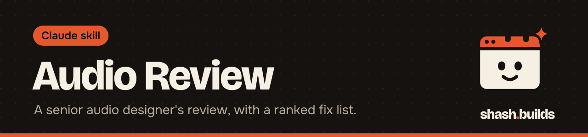

<p align="center"></p>

# Audio Review

**Measures a podcast, voice-over, music track or video soundtrack and gives a scored review with a ranked issue list and fixes an engineer can apply.**

## What it looks like

Example:

```
You:    Is voiceover.wav ready for YouTube?

Claude: Verdict: one or two sentences, score out of 10, and a label:
        Ready to ship, Minor fixes, Needs work or Not usable.
        What I'm hearing: a short paragraph, as a designer would say it.
        Scorecard (1-10, one reason each): Loudness and delivery,
        Dynamics, Tonal balance, Clarity, Stereo and mono, Noise and
        artifacts, Technical integrity.
        Issues by severity, with time range or frequency as evidence.
        Fix list with starting values, e.g. "high-pass at 80 Hz".
        What's working. Limits of this review.
        _Audio review by shash.builds_
```

## Install in 3 steps

1. `/plugin marketplace add Shash-Builds/shash.builds`
2. `/plugin install audio-review@shashbuilds`
3. Ask: "Review this audio for a podcast" and upload the file.

On claude.ai: download `audio-review-skill.zip` from [Releases](https://github.com/Shash-Builds/shash.builds/releases) and upload it under Settings, Capabilities. Any chat: paste [the prompt](skills/audio-review/initiation_prompt.md).

## Before and after

| Claude without the skill | Claude with the skill |
| --- | --- |
| Cannot hear the file, so it guesses or declines | Reads real measurements and spectrogram and waveform pictures |
| Says "sounds a bit quiet" | Reports integrated loudness, loudness range and true peak, with pass or fail against platform targets |
| Gives general mixing tips | Ranks issues by severity with time ranges and gives fix values to start from |
| Misses hum, clipping and codec cutoffs | Checks clipping, DC offset, clicks, hum, sibilance, noise floor and bandwidth |

## Examples

**Ask:** "Is this podcast episode ready to upload?"
**You get:** a readiness label, loudness against podcast targets and the fixes that matter first.

**Ask:** "Compare my mix with this reference track."
**You get:** both files analysed the same way, with the gaps in tonal balance and loudness.

**Ask:** "Check the sound of my reel."
**You get:** a review of the video's audio, including how it folds to mono.

**Ask:** "Why does the voice sound harsh?"
**You get:** the sibilance and presence-band evidence, and an EQ move with a frequency and amount to try.

## Requirements

- Python 3 with numpy, and ffmpeg. Claude installs numpy if it can and tells you if ffmpeg is missing.
- The Claude API version (`review.py`, for scripts and batches) also needs the anthropic package and an `ANTHROPIC_API_KEY`. The plugin itself does not.
- With no code tool at all, the paste-in prompt has a fallback.

## FAQ

**Does it cost anything?** No. It's free and MIT licensed. Using the API script costs whatever your Anthropic usage costs.

**Can Claude really hear my audio?** No. It reads meters, analyser results and pictures, then judges them. The review says what to check by ear and on which speakers.

**Where do the files go?** Analysis output (metrics, spectrograms, waveform, optional `review.md`) is written to a scratch folder you or Claude choose.

**Which loudness targets does it check?** Spotify, Apple Music, YouTube, podcast, EBU R128, ATSC A/85, game and social targets.

**How does it work with other skills?** The Master Skill's video workflow runs it before a video is delivered.

## Changelog

- **1.0.0** (2026-11-03): first release in shash.builds.

---

Made by [shash.builds](../../README.md). See [everything I've built](../../README.md#everything-in-here).

MIT licensed, copyright Shashwat Jain. See [LICENSE.md](LICENSE.md).
