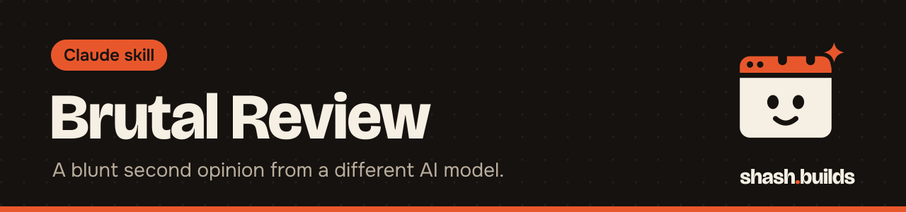

<p align="center"></p>

# Brutal Review

**Sends your plan, pitch, resume or code to a different AI model and brings back a blunt, structured critique: a verdict, a score out of 100, weaknesses ranked critical to minor with a fix for each, and the most likely reason it fails in 6 months.**

A model reviewing its own work goes easy on it. Another model has different blind spots.

## What it looks like

Example (a made-up plan, the shape of a real reply):

```
Verdict: A good offer aimed at nobody in particular.
Score: 41/100
1. [critical] No named first buyer: the plan says "small businesses".
   Fix: Pick one trade in one city and list 50 of them by name this week.
2. [major] Price has no anchor: $400 with nothing to compare it to.
   Fix: Show what an agency charges for the same page.
3. [minor] The timeline skips client feedback days.
   Fix: Add two buffer days to the 7-day promise.
Most likely reason it fails in 6 months: outreach stalls because nobody owns it daily.
```

Claude shows the critique word for word and never writes or softens it. After it, Claude may add its own view under "Claude's take".

## Install in 3 steps

1. `/plugin marketplace add Shash-Builds/shash.builds`
2. `/plugin install brutal-review@shashbuilds`
3. Set one provider key in your environment (for example `export OPENAI_API_KEY=...`), then ask: "Brutal review this plan, head chef style."

Claude Code only: it needs to run a script and reach the provider.

## Styles

| Style | What the reviewer does |
| --- | --- |
| `headchef` (default) | Short, surgical, no softening. Every complaint comes with the exact fix |
| `devil` | Builds the strongest case that it won't work, and names the assumption under each weakness |
| `redteam` | Attacks it: where it breaks, who exploits it, what fails under load |

## Providers and keys

| Provider | Key (environment only) | Default model |
| --- | --- | --- |
| OpenAI | `OPENAI_API_KEY` | `gpt-4o` |
| xAI | `XAI_API_KEY` | `grok-3` |
| Anthropic | `ANTHROPIC_API_KEY` | `claude-sonnet-5-5` |
| Google | `GOOGLE_API_KEY` | `gemini-2.5-pro` |
| Ollama (local) | none, `OLLAMA_HOST` optional | `llama3.1` |
| claude CLI | none | your Claude Code default |

Model names change: pass `--model` with your provider's current name. With no `--provider`, the first key found wins; with no key, it uses the `claude` CLI and says that's the same model family. Keys are never asked for in chat and never printed.

## Privacy

Before anything is sent, the script replaces emails, phone numbers and anything that looks like an API key, then prints which provider gets how many characters and what it removed. `--dry-run` shows the exact text without sending it. Claude asks once per session before the first send.

## Before and after

| Without the skill | With the skill |
| --- | --- |
| Claude reviews Claude's plan and mostly agrees | A different model scores it and lists what breaks |
| "Looks solid, a few small tweaks" | Critical, major and minor issues, each with a concrete fix |
| You find the fatal flaw in month 3 | The likeliest 6-month failure, named on day 1 |

## Requirements

Python 3 (standard library only) and one of: a provider key, a local Ollama, or the `claude` CLI.

## FAQ

**How is this different from Harsh Buyer Review and Careful Mode?** Harsh Buyer Review is a buyer's view of a product, with competitor research. Careful Mode is Claude checking its own work. Brutal Review is a different model's view of plans, pitches, resumes and code.

**What if the reviewer replies with junk?** The script checks the reply's shape, asks once more, and then stops with a plain error. Nothing gets made up.

**Does it cost money?** The skill is free. Your provider bills your key as usual; Ollama and the claude CLI use what you already have.

## Credit

Inspired by the idea in [zaripych/skills-brutal](https://github.com/zaripych/skills-brutal). That project has no license, so no code, prompts or wording were copied: everything here is written from scratch.

## Changelog

- **1.0.0** (2026-11-04): first release in shash.builds.

---

Made by [shash.builds](../../README.md). Need a one-page website for your service business? [$400 flat, live in 7 days](../../README.md#hire-me).

MIT licensed, copyright Shashwat Jain. See [LICENSE.md](LICENSE.md).
