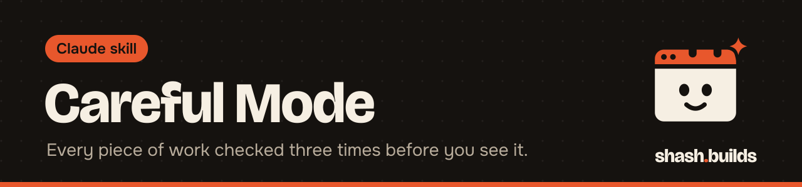

<p align="center"></p>

# Careful Mode

**Claude reviews every piece of work three times (is it right, is it complete, how could it go wrong) before it hands it over. Built for prices, contracts, customer emails and anything hard to undo.**

## What it looks like

Example:

```
You: Careful mode on. Update the three prices in the catalog and write the customer email.

Claude: [does the work, then reviews it three times and ends with a record]

Careful mode: reviewed 3x
1. Correctness: checked each price against the source file; redid the totals a second way.
2. Completeness: all requirements met; nothing extra added.
3. Adversarial: found one inconsistent product name, fixed it; nothing irreversible.
Not verified: the live checkout page (no access).
```

The wording of the record changes with your task. It always says what was checked and what was not.

## Install in 3 steps

1. `/plugin marketplace add Shash-Builds/shash.builds`
2. `/plugin install careful-mode@shashbuilds`
3. Say "careful mode on" before a task that matters.

On claude.ai: download `careful-mode-skill.zip` from [Releases](https://github.com/Shash-Builds/shash.builds/releases) and upload it under Settings, Capabilities. Any chat: paste [the prompt](skills/careful-mode/careful-mode.md).

## Before and after

| Without the skill | With the skill |
| --- | --- |
| Claude answers once and hands it over | Three separate passes, each with a different job: correctness, completeness, then a hostile read |
| A small slip in a number or name reaches you | Facts, numbers, names and dates are checked against the source again, and calculations are redone a second way |
| A fix can add a new mistake | If any pass finds a problem, it fixes it and restarts from review 1 |
| You can't tell what was checked | The reply ends with a short record, including anything it could not verify |

## Examples

**Ask:** "Careful mode: change the price of the 500 g pack in the sheet."
**You get:** The edit, plus a record showing the new price was checked against the source and no other row changed.

**Ask:** "Triple check this email to a customer before I send it."
**You get:** The email checked for facts, every requirement you listed, and anything that could embarrass you if the customer read it closely.

**Ask:** "Be extremely careful, this goes to production."
**You get:** Code traced with real examples, including empty and large inputs, with tests or the code run where possible, and a warning before anything that cannot be undone.

**Ask:** "Careful mode off."
**You get:** Claude goes back to normal behavior.

## FAQ

**Does it cost anything?** The skill is free and MIT licensed. It uses more of your Claude usage because it does three passes, so keep it for work that matters.

**How long does it stay on?** For the rest of the session, until you say "careful mode off".

**Does it ask me questions?** Yes, if something is unclear and the answer changes what it would do. It looks at the real files and data and does not rely on memory.

**Does it work with Economy Mode?** Yes. Economy Mode may hand the work itself to a cheaper helper, but Careful Mode keeps all three reviews on the main model and treats a helper's output like its own work.

**What if it can't verify something?** It says so plainly. If it is still unsure after three passes, it tells you what it is unsure about instead of presenting the work as certain.

## Changelog

- **1.0.0** (2026-11-03): first release in shash.builds.

---

Made by [shash.builds](../../README.md). See [everything I've built](../../README.md#everything-in-here).

MIT licensed, copyright Shashwat Jain. See [LICENSE.md](LICENSE.md).
