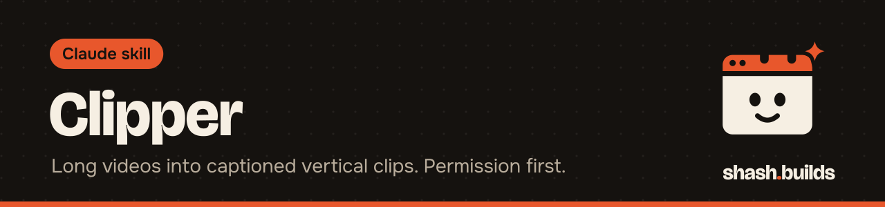

<p align="center"></p>

# Clipper

**Turns a long video you have permission to use into vertical Shorts, Reels and TikToks with word-by-word captions and a hook line, for paid clipping campaigns or your own channel.**

## What it looks like

Example:

```
You: Clip this podcast for the campaign. Brief is pasted below. 20 to 45 seconds, Reels and Shorts, must tag @brand.

Claude: Saved clips/brand-podcast/brief.md. Transcribed the episode, ranked the candidate spans,
and read each one's first and last lines. Kept 4.

Clip 1  (312.4s to 351.0s)
Hook on screen: Why most founders underprice
Why it works: opens on a full thought, has a turn ("but the reason"), ends on a finished line.
Caption: [your text, with @brand exactly as the brief says]
Check: confirm the guest's name spelling.

Clip 2 ... Clip 4

4 clips for the brand podcast campaign. Deadline from the brief: Friday.
```

That is the shape of the hand-back: the file, the hook, the caption with the required tags, the source span, and anything you must check. Details are filled in from your video and brief.

## Install in 3 steps

1. `/plugin marketplace add ShashwatBuilds/shash.builds`
2. `/plugin install clipper@shashbuilds`
3. Ask: "Clip this video into three Shorts" and give it the file, plus the campaign brief if there is one.

On claude.ai: download `clipper-skill.zip` from [Releases](https://github.com/ShashwatBuilds/shash.builds/releases) and upload it under Settings, Capabilities. Any chat: paste [the prompt](skills/clipper/clipper.md).

## Before and after

| Without the skill | With the skill |
| --- | --- |
| Claude suggests timestamps by guessing from the topic | It transcribes the video, then a script ranks spans that open on a complete thought, contain a turn and end on a finished sentence. Claude reads each one and picks |
| You cut, reframe and caption by hand | A script cuts each span to 9:16, burns in word-by-word captions from the transcript, adds a hook line and sets sound to -14 LUFS |
| The campaign rules get skimmed | The brief is saved first and followed word for word: length, tags, mentions, banned edits |
| Earnings are a rough guess | Earnings are worked out in code from the brief's rate, cap and fee |

## Examples

**Ask:** "Find the best moments in this 90-minute interview. I own the video."
**You get:** A ranked list of candidate spans from the transcript, with the first and last line of each and why Claude kept or dropped it.

**Ask:** "Cut spans 312 to 351 and 1204 to 1248 as Shorts, crop to the speaker on the left."
**You get:** Two vertical clips with captions and a hook line each. Claude checks the length against your brief and the start and end of each clip before handing them over.

**Ask:** "Here is the campaign page. Is it worth my time?"
**You get:** A `brief.md` with rate, budget left, caps, length, required tags and banned edits, and a note if the budget left looks too small.

**Ask:** "Write the captions for these clips. The brief needs #ad."
**You get:** A title or caption per platform with every required tag in place, ready to paste.

## Requirements

- Python 3 and [ffmpeg](https://ffmpeg.org/download.html) (with libass, which most builds have) for cutting.
- A transcript. The `transcriber` skill makes one with word timings, and an .srt or .vtt from the campaign also works.

## FAQ

**Does it cost anything?** No. It's free and MIT licensed. Your own Claude plan covers the usage.

**Whose videos can I clip?** Only videos you have permission to use: a campaign that hires clippers, your own videos, or a creator who said yes in writing. It will not help you clip someone else's video just because it is popular.

**Does it post for me?** No. It never logs in to a platform or a campaign site, and it never posts, schedules or submits. You get the files and the text, and you post.

**Where do the files go?** In `clips/<campaign>/` in your project, with the `brief.md` next to the clips.

**Does it change what the speaker said?** No. Captions are the speaker's exact words, and the hook line cannot claim something the speaker did not say.

**How does it work with other skills?** If installed, it uses `transcriber` for the transcript, `social-media` to score hook options and log posts, `humanizer` for the caption text and `motion-design-taste` to check each clip.

## Changelog

- **1.0.0** (2026-11-03): first release in shash.builds.

---

Made by [shash.builds](../../README.md). Need a one-page website for your service business? [$400 flat, live in 7 days](../../README.md#hire-me).

MIT licensed, copyright Shashwat Jain. See [LICENSE.md](LICENSE.md).
