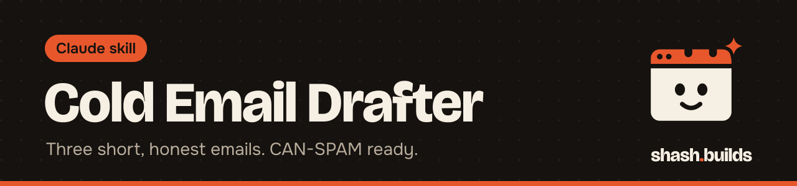

<p align="center"></p>

# Cold Email Drafter

**Writes a three-email sequence to a local business from a site-audit result and a mock link: a first email of 90 words or fewer, then follow-ups on day 3 and day 7, in plain text, with CAN-SPAM basics and a script that checks it. Built for web designers who want to send emails an owner might actually answer.**

This is step 4 of a four-skill sales kit: [lead-finder](../lead-finder) -> [site-audit](../site-audit) -> [mock-builder](../mock-builder) -> **cold-email-drafter**. The Master Skill's Sales head runs them in order, and each one also works alone.

## What it looks like

Example (made-up business, made-up mock link). This is the starting draft from `email_tool.py draft`, built from an audit of "Demo Plumbing Co" in Austin. Claude then rewrites the personal line so it sounds like a person who looked.

```
===== EMAIL 1 (day 0) =====
Subject: Demo Plumbing Co homepage idea

Hi Sam,

I looked at Demo Plumbing Co's website and noticed one thing: there is no tap-to-call or booking button, so a visitor on a phone has to copy the number by hand.

So I mocked up a cleaner one-page site for you. Take a look:
https://demo-site.example/previews/demo-plumbing-co/

Want it live in 7 days for $400?

Your Name
[[YOUR POSTAL ADDRESS: street, city, country]]
Not interested? Reply "no thanks" and I won't email again.

===== EMAIL 2 (day 3) =====
Subject: Re: Demo Plumbing Co homepage idea

Hi Sam,

Quick follow-up on the mockup I made for Demo Plumbing Co:
https://demo-site.example/previews/demo-plumbing-co/

Happy to change anything on it. Want me to make it live?

Your Name
[[YOUR POSTAL ADDRESS: street, city, country]]
Not interested? Reply "no thanks" and I won't email again.

===== EMAIL 3 (day 7) =====
Subject: Re: Demo Plumbing Co homepage idea

Hi Sam,

Last note from me. The mockup stays up for a while if you want it later:
https://demo-site.example/previews/demo-plumbing-co/

If the timing is wrong, no problem at all.

Your Name
[[YOUR POSTAL ADDRESS: street, city, country]]
Not interested? Reply "no thanks" and I won't email again.
```

The draft's checker then reports: `ok: 3 emails pass. Email 1 body: 57 words.` The word count skips the subject line, the postal address line and the opt-out line. Your real name goes where "Your Name" is, and your real postal address replaces the placeholder.

If the audit score is under 30, the draft step warns you that the site is already strong, so a pitch about it will feel thin. Consider skipping that business.

## The rules it follows

- **Email 1:** subject, greeting, one personal line, the mock link, a soft question and a sign-off. 90 words or fewer.
- **Follow-ups** on day 3 and day 7 are shorter, use the same thread subject and carry no guilt. Send them as replies in the same thread.
- **Plain text.** One link. No attachments, no images, no tracking pixels.
- **One provable thing.** The personal line comes from the audit and names something the owner can check.
- **Honest.** No em dashes, no hype, no fake familiarity, no claims about results. The offer line stays "Want it live in 7 days for $400?" unless your offer differs.

## CAN-SPAM basics

In the US, commercial email must follow the CAN-SPAM Act. The basics this skill builds in: your real name, a valid postal address, and a clear, working way to opt out, and you must honor every opt-out. This is not legal advice. Read the [FTC's compliance guide](https://www.ftc.gov/business-guidance/resources/can-spam-act-compliance-guide-business) before you send.

## The checker

```
python3 email_tool.py check emails.txt
```

It fails the sequence if email 1's body is over 90 words, or if any email has an em dash, a hype or spam phrase, more than one link, no subject line, no one-line opt-out or no postal address line. It also reminds you to fill in the address placeholder. Fix everything it reports.

## Install in 3 steps

1. `/plugin marketplace add ShashwatBuilds/shash.builds`
2. `/plugin install cold-email-drafter@shashbuilds`
3. Say "write the cold email for Demo Plumbing Co" with the audit and the mock link.

On claude.ai: download `cold-email-drafter-skill.zip` from [Releases](https://github.com/ShashwatBuilds/shash.builds/releases) and upload it under Settings, Capabilities. It runs a Python script, so it works best in Claude Code or anywhere Claude can run code. See [the skill file](skills/cold-email-drafter/SKILL.md).

## Before and after

| Without the skill | With the skill |
| --- | --- |
| A long email about you and your services | A short email about one thing on their site, with a mock they can open |
| A sequence of nagging follow-ups | Two short follow-ups, no guilt, then you stop |
| The postal address and opt-out get forgotten | Both are in every email, and the checker fails an email without them |
| Hype words and em dashes slip in | The checker flags them before you send |

## Examples

**Ask:** "Write the cold email for Demo Plumbing Co. Audit is in audit.json, mock is at the link below."
**You get:** Three emails in plain text, with the personal line taken from the top audit problem.

**Ask:** "This business has no website. Write the email."
**You get:** A first email that says you searched for them and found only directory listings, and offers a one-page site.

**Ask:** "Check emails.txt."
**You get:** A list of what to fix, or the word count of email 1 if it passes.

## Requirements

- Python 3, standard library only.
- A [site-audit](../site-audit) JSON and a [mock-builder](../mock-builder) link, or at least the top problem and a link.
- Your real name and a real postal address.
- The owner's first name only if it is public, such as on their own site or Google profile.

## FAQ

**Does it cost anything?** No. It's free and MIT licensed.

**Does it send the emails?** No. It drafts and checks. You send them from your own account.

**Where do I get leads to email?** From [lead-finder](../lead-finder). Keep that list private.

**Does the checker make me legal?** No. It catches common slips. Compliance is your job, so read the FTC guide linked above.

**What if I don't use the same offer?** Change the offer line. Everything else stays short and honest.

## Changelog

- **1.0.0** (2026-11-03): first release in shash.builds.

---

Made by [shash.builds](../../README.md). Need a one-page website for your service business? [$400 flat, live in 7 days](../../README.md#hire-me).

MIT licensed, copyright Shashwat Jain. See [LICENSE.md](LICENSE.md).
