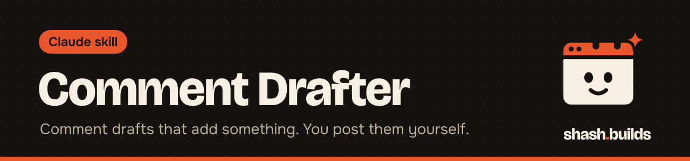

<p align="center"></p>

# Comment Drafter

**Give it the posts you want to comment on (LinkedIn, X or Instagram) and get two comment options for each, in your voice, that add something real. Drafts only: it never posts, likes, logs in or automates anything.**

## What it looks like

Example (a made-up post and person):

```
Post 1 (LinkedIn): "Most small business websites lose leads at the contact form."
  What it says: forms with too many fields kill enquiries.

  Add: I rebuilt a cleaner's quote form from 9 fields to 3 last month. The owner
       said the calls started mentioning the site. Which field do you cut first?
  Ask: Do you see the drop more on phones? Most of the forms I audit hide the
       call button below the form on mobile.
```

The second option is always a specific question. Neither has a link, a pitch or "Great post!".

## Install in 3 steps

1. `/plugin marketplace add Shash-Builds/shash.builds`
2. `/plugin install comment-drafter@shashbuilds`
3. Paste 5 to 10 posts and ask: "Draft my comments for these."

On claude.ai: download `comment-drafter-skill.zip` from [Releases](https://github.com/Shash-Builds/shash.builds/releases) and upload it under Settings, Capabilities. Any chat: paste [the SKILL.md](skills/comment-drafter/SKILL.md).

## Before and after

| Without the skill | With the skill |
| --- | --- |
| "Great insights, thanks for sharing!" | One real angle or one specific question per comment |
| Comments that quietly pitch your service | No links, no "DM me", no pitch |
| A bot that comments for you and gets the account flagged | Drafts you read, pick and post yourself |

## Examples

- "Draft comments for these 10 posts from founders in home services." Two options each, LinkedIn length.
- "Reply ideas for this X thread." Under 280 characters each.
- "Help me hit my 10 comments today." It drafts the batch and offers to log the count to your daily quest.

## Works well with

[LinkedIn](../linkedin) (its comment check) and [Humanizer](../humanizer) (no machine phrasing). If they're installed, the drafter runs their checks on every comment.

## FAQ

**Will it post for me?** No. It never posts, likes, follows or logs in. Automating comments can break platform rules and gets accounts restricted.

**Can it read the post from a link?** Paste the post text or a screenshot. It works only from what you give it.

**Will it make up experiences?** No. It uses only things you've told it you did or saw.

## Changelog

- **1.0.0** (2026-11-04): first release in shash.builds.

---

Made by [shash.builds](../../README.md). Need a one-page website for your service business? [$400 flat, live in 7 days](../../README.md#hire-me).

MIT licensed, copyright Shashwat Jain. See [LICENSE.md](LICENSE.md).
