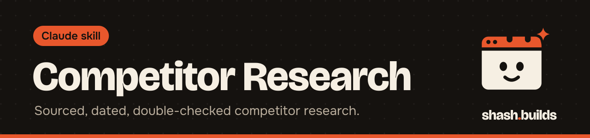

<p align="center"></p>

# Competitor Research

**Evidence-based competitor research on marketplaces, competitor websites, social media and ad libraries: every fact has a source and a date, a separate pass checks it, and scripts do the maths.**

## What it looks like

Example:

```
You: Research my competitors for stainless steel water bottles on Amazon India. Deep, please.

Claude: Saved research/steel-bottle-2026-11-03/brief.md. Scout found these competitors: [list].
Change any before I go on? ... (collectors, verifier and analyst then run)

Answer: [three sentences from report.md]
Five ranked actions: [each tied to evidence rows like [c3-014]]
Data note: collected 2026-11-03, 6 competitors, 2 pages blocked (marked "blocked")
Folder: research/steel-bottle-2026-11-03/  (report.md and tables.md are ready for a harsh buyer review)
```

Names, numbers and findings come from the pages it actually reads. The shape above is the output format the skill specifies.

## Install in 3 steps

1. `/plugin marketplace add ShashwatBuilds/shash.builds`
2. `/plugin install competitor-research@shashbuilds`
3. Ask: "Research the competitors for my product" and say what you sell, where, and the question you want answered.

On claude.ai: download `competitor-research-skill.zip` from [Releases](https://github.com/ShashwatBuilds/shash.builds/releases) and upload it under Settings, Capabilities. Any chat: paste [the prompt](skills/competitor-research/competitor-research.md). Pick Haiku as the model to save credits.

## Before and after

| Without the skill | With the skill |
| --- | --- |
| A summary from memory, with prices that may be old | Every value has the URL it came from and the date it was seen. No URL, no fact |
| Gaps get filled with plausible guesses | Missing values are written "not found" and blocked pages "blocked" |
| Averages and rankings done by feel | Unit prices, discounts and rankings are computed by a script |
| Claude reads everything on the main model | Helpers on Haiku collect the data one competitor at a time; a separate verifier re-checks a sample |

## Examples

**Ask:** "Quick research on the three main competitors for my phone stand."
**You get:** A Quick-level run (3 competitors, main listing, price, rating, top 10 reviews) with a report and tables.

**Ask:** "What do buyers of my competitors complain about most?"
**You get:** Review complaints coded across competitors, so the ones that appear for several of them show up as unsolved problems in the market.

**Ask:** "Where is the price gap in this market?"
**You get:** The competitors' price ladder and price bands from the computed tables, and price points nobody covers, each with its evidence.

**Ask:** "Now give me harsh feedback on my listing."
**You get:** The research is handed to the `harsh-buyer-review` skill, so it does not research again.

## Requirements

- Claude Code with web search for the full helper run. Without helpers, Claude follows the same steps itself, one competitor at a time.
- Python 3 for the ledger script.
- Optional for reading pages in a real browser: Node.js and Playwright with Chromium.

## FAQ

**Does it cost anything?** The skill is free and MIT licensed. It is built to run on Haiku to keep your Claude usage low.

**How deep does it go?** Quick (3 competitors), Deep (5 to 8, the default) or Exhaustive (10 to 15). You can choose.

**Where do the files go?** In `research/<short-name>-<date>/` in your project: the brief, competitors, the ledger of sourced facts, `tables.md` and `report.md`.

**Does it log in or get around blocks?** No. It reads public pages at human pace, does not bypass captchas or paywalls, does not collect reviewers' personal data, and records "blocked" when a site stops it.

**Does it write my listing or ads?** No. It is analysis only. Its actions are decisions for you, such as price, product, listing and channel.

## Changelog

- **1.0.0** (2026-11-03): first release in shash.builds.

---

Made by [shash.builds](../../README.md). Need a one-page website for your service business? [$400 flat, live in 7 days](../../README.md#hire-me).

MIT licensed, copyright Shashwat Jain. See [LICENSE.md](LICENSE.md).
