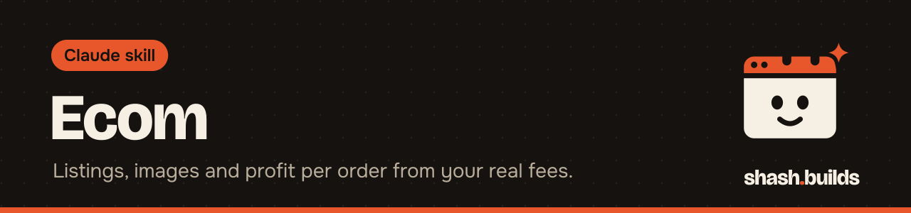

<p align="center"></p>

# Ecom

**An e-commerce operator for founders selling on any marketplace or their own store: listings, product images, profit per order from your real fees, ads, returns and stock.**

## What it looks like

Example:

```
You: I sell at 999 on Amazon India, cost 280. What do I make per order, and should I go to 1,099?

Claude: Ecom: pricing for Amazon India.
Inputs: price, cost, packaging, weight, tax rate, fee profile (source and date).
[unit economics from economics.py: profit per order, break-even price, target-margin price]
Price sweep: profit falls as price rises somewhere in this range. [flagged]
Next actions: 1 ... 2 ...
```

The numbers come from your inputs and fee profile. A real run of the same question is in [the ecom-unit-economics example](../../examples/ecom-unit-economics).

## Install in 3 steps

1. `/plugin marketplace add Shash-Builds/shash.builds`
2. `/plugin install ecom@shashbuilds`
3. Ask: "What do I make per order on this product?" and give the price, your cost and where you sell.

On claude.ai: download `ecom-skill.zip` from [Releases](https://github.com/Shash-Builds/shash.builds/releases) and upload it under Settings, Capabilities. Any chat: paste [the prompt](skills/ecom/ecom.md), plus the module you need from [modules](skills/ecom/modules) and the marketplace's section of [marketplaces.md](skills/ecom/marketplaces.md).

## Before and after

| Without the skill | With the skill |
| --- | --- |
| Margin worked out in the chat, with remembered fee rates | Every fee, margin, break-even and ACoS comes from a script, with the inputs shown |
| Marketplace rules quoted from memory | Fees and rules come from your fee profile or the marketplace's current pages, with the date checked. Unchecked figures are labelled unverified |
| You re-explain your store each session | It reads store files in your project's `ecom/` folder first |
| Product facts can be filled in to make copy flow | Missing facts become clearly marked gaps, never guesses |

## Examples

**Ask:** "What price should I charge to keep a 25% margin?"
**You get:** The target price, the break-even price and a price sweep, worked out in code from your fee profile.

**Ask:** "Write the Amazon listing for this product."
**You get:** A listing prepared for you to upload, with title, bullets and keywords checked for lengths and risky words by a script. Facts you did not give are marked as gaps.

**Ask:** "Check these 7 product images for Flipkart."
**You get:** Image measurements and phone-size previews checked against the marketplace's image rules, and a plan for fixes. It can also render infographics and comparison charts from templates.

**Ask:** "Here is my ads report. Which campaigns lose money?"
**You get:** ACoS and TACoS from the report computed by `ops.py`, which also handles returns and reorder reports.

## Requirements

- Python 3 for the calculations and listing checks.
- ffmpeg for the image checks.
- Node.js with Playwright for rendering infographics.
- Web access to check current marketplace fees and rules.

## FAQ

**Does it cost anything?** No. It's free and MIT licensed.

**Which marketplaces?** Amazon in every region, Walmart, eBay, Etsy, TikTok Shop, Shopify and other own stores, Flipkart, Meesho, Myntra, Ajio, Nykaa, Shopee, Lazada, Mercado Libre, Noon, Zalando, Allegro, Rakuten and others.

**Where does my store info go?** In an `ecom/` folder in your project (`store.md`, `products.csv`, fee profiles, listings, learnings). With no project, in Claude Code's plugin data folder. Never inside the plugin itself.

**Does it change my live listings?** No. It prepares listings, prices and files. You decide and publish.

**Does it give tax advice?** No. It shows how GST, VAT or sales tax changes the numbers, using the rates you confirm. For registration, compliance or disputes, it says to ask an accountant or lawyer.

**How does it work with other skills?** If installed, it uses `competitor-research` first, `harsh-buyer-review` on finished listings and images, `careful-mode` on prices and uploads, and `economy-mode` for bulk reading.

## Changelog

- **1.0.0** (2026-11-03): first release in shash.builds.

---

Made by [shash.builds](../../README.md). See [everything I've built](../../README.md#everything-in-here).

MIT licensed, copyright Shashwat Jain. See [LICENSE.md](LICENSE.md).
