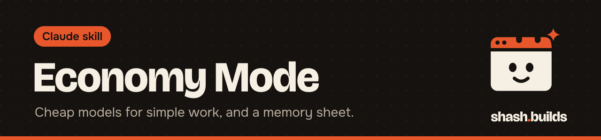

<p align="center"></p>

# Economy Mode

**Claude sends simple work to cheaper models (Haiku, Sonnet), keeps the strongest model for decisions and review, and keeps a memory sheet so it remembers your decisions across sessions. For Claude Code users.**

## What it looks like

Example:

```
You: Economy mode. Find every file that mentions the old price, rename the product images, and write
the descriptions for the three new SKUs.

Claude: [finds files and renames images on Haiku, writes the descriptions on Sonnet, skims each
result, handles pricing decisions itself]

Economy mode: 2 tasks on Haiku, 1 on Sonnet, 1 handled directly.
```

The final line always lists what was delegated. The counts depend on your task.

## Install in 3 steps

1. `/plugin marketplace add Shash-Builds/shash.builds`
2. `/plugin install economy-mode@shashbuilds`
3. Say "economy mode" at the start of a session, or "remember this: ..." to save a decision.

Economy Mode works in Claude Code only. It needs Claude Code's subagents, so there is no claude.ai zip and no paste-in prompt.

## Before and after

| Without the skill | With the skill |
| --- | --- |
| Every file search and reformat runs on the main model | Each task is classed low, medium or high. Low goes to a Haiku helper, medium to a Sonnet helper |
| Judgment calls might get delegated to save cost | High-stakes work (architecture, security, payments, anything irreversible) stays on the main model. When unsure, it picks the higher tier |
| You repeat your prices and decisions after /clear | Decisions go into `memory/memory.csv`. Claude searches it before asking you again |
| Helpers need the project explained each time | Helpers get the sheet's standing brief with one command |

## Examples

**Ask:** "Economy mode. Rename all product photos to match the SKU list."
**You get:** A Haiku helper does the renaming. Claude skims the result and reports what was delegated.

**Ask:** "Remember this: joggers stay at 999 until Diwali."
**You get:** A row added to the memory sheet as a decision. After /clear or in a new session, Claude finds it with a search instead of asking you.

**Ask:** "What did I decide about packaging?"
**You get:** The best five matching rows from the sheet, not the whole sheet.

**Ask:** "Economy mode off."
**You get:** Claude stops delegating by tier and goes back to normal behavior.

## Requirements

- Claude Code with the plugin installed (the helpers are `economy-mode:quick-task` and `economy-mode:standard-task`).
- Python 3 for the memory sheet script. It uses only the standard library.

## FAQ

**Does it cost anything?** The skill is free and MIT licensed. It aims to lower your Claude usage by moving simple work to cheaper models. Starting a helper has its own cost, so it does not delegate one-call jobs.

**Where does the memory go?** In `memory/memory.csv` in your project. Excel and Google Sheets open it directly. Rows can be updated, or forgotten, which hides them but keeps them in the sheet.

**Will it store my passwords?** No. It is told never to store passwords, card numbers or other secrets.

**What if a cheaper model gets it wrong?** Claude skims every result. If a helper replies "ESCALATE:" or the result looks wrong, the task moves up one tier instead of retrying the same one.

**Does it work with the other skills?** Yes. `careful-mode` still does all three reviews on the main model, and `ecom` and `competitor-research` can use it for bulk work and for reading your project's memory sheet.

## Changelog

- **1.0.0** (2026-11-03): first release in shash.builds.

---

Made by [shash.builds](../../README.md). Need a one-page website for your service business? [$400 flat, live in 7 days](../../README.md#hire-me).

MIT licensed, copyright Shashwat Jain. See [LICENSE.md](LICENSE.md).
