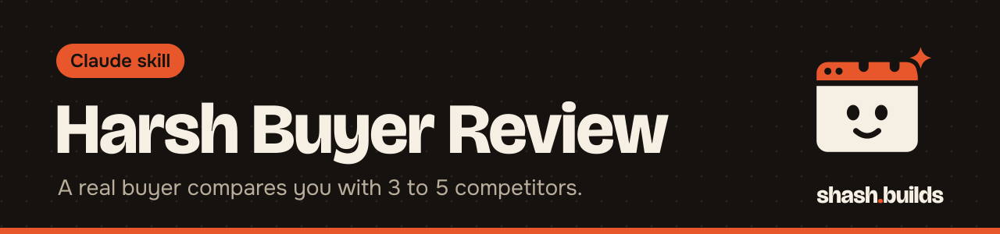

<p align="center"></p>

# Harsh Buyer Review

**Claude becomes a skeptical real buyer, researches 3 to 5 of your competitors, compares you one-on-one, and tells you exactly why they would or would not buy.**

## What it looks like

Example:

```
You: Review my Amazon listing like a harsh buyer. [link and price]

Claude:
1. Quick reaction: Skip. I can't tell what's in the box.
2. Competitor research summary: 4 competitors, with URLs and dates checked.
3. One-on-one comparison table: you vs each competitor.
4. Harsh feedback A to J: first impression, title, images, price and value, trust,
   quoting your exact words.
5. Top 10 fixes I'd demand, ranked by how much each changes my decision.
6. What would make me buy today: at most five changes.
```

The real review carries your product's actual details and cited competitor facts. The section order above is the format the skill requires every time.

## Install in 3 steps

1. `/plugin marketplace add ShashwatBuilds/shash.builds`
2. `/plugin install harsh-buyer-review@shashbuilds`
3. Ask: "Review this listing like a harsh buyer" and share the link, screenshots, or your product and price.

On claude.ai: download `harsh-buyer-review-skill.zip` from [Releases](https://github.com/ShashwatBuilds/shash.builds/releases) and upload it under Settings, Capabilities. Any chat: paste [the prompt](skills/harsh-buyer-review/harsh-buyer-reviewer.md) (fill in sections 1 to 3 about your product, price, market and buyer first).

## Before and after

| Without the skill | With the skill |
| --- | --- |
| Polite feedback: "consider improving your images" | A buyer's voice quoting your exact words and naming the smallest text size they can still read |
| No comparison with the market | 3 to 5 researched competitors, each compared one-on-one, with URLs and dates |
| A loose list of suggestions | Ten ranked fixes, each a concrete instruction, plus at most five changes that would make the buyer purchase today |
| Reviews skip the ugly part | It writes the one-star review the buyer would post, unsoftened |

## Examples

**Ask:** "Review my product listing like a harsh buyer."
**You get:** The full review in the fixed order: quick reaction, competitor summary, comparison table, feedback in sections A to J, top 10 fixes and what would make the buyer buy.

**Ask:** "Would you buy this at 899 or is it too high?"
**You get:** A price and value verdict against the unit prices of the competitors it found, and whether any claim feels like a hidden cost.

**Ask:** "Go through my 30-second ad second by second."
**You get:** A second-by-second pass over the opening, voiceover, transitions, text cards, sound changes and end card, and whether it works on mute.

**Ask:** "Here is my packaging photo."
**You get:** What the buyer sees at phone size, what looks like a render, and what is missing before they would trust it.

## Requirements

- Web search, which Claude Code has built in. Without it, Claude says so at the start, asks you for competitor links or screenshots, and marks anything it could not check as "not verified".

## FAQ

**Does it cost anything?** No. It's free and MIT licensed. The research uses your normal Claude usage.

**Will it rewrite my listing?** No. The buyer critiques and does not write copy or redesign images. The `ecom` skill fixes the listing.

**Does it make up competitor data?** It is told not to. Every competitor fact needs a source or the words "not found".

**Can I skip the research?** The research is required for every review. If you already ran the `competitor-research` skill, hand over its `report.md` and `tables.md` and Claude will not research again.

**Can I send a second item?** Yes. It reviews the next item in full and reuses the competitor research, unless the new item needs facts the research does not cover.

## Changelog

- **1.0.0** (2026-11-03): first release in shash.builds.

---

Made by [shash.builds](../../README.md). Need a one-page website for your service business? [$400 flat, live in 7 days](../../README.md#hire-me).

MIT licensed, copyright Shashwat Jain. See [LICENSE.md](LICENSE.md).
