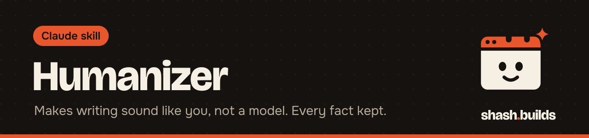

<p align="center"></p>

# Humanizer

**Rewrites posts, captions, listings, emails, scripts and replies so they sound like the founder wrote them, and checks that no fact changed.**

## What it looks like

Example:

```
You:    Humanize this LinkedIn post. Our joggers launch at Rs 999.
        "I'm thrilled to announce our amazing joggers!
        Our mission is to redefine comfort."

Claude: Our joggers kept bagging at the knee. So we changed the fabric.
        They launch at Rs 999.

        Humanizer: 31 to 92, LinkedIn
        Facts unchanged: price kept.
        Left on purpose: none.
        Need from you: the fabric weight, if you want it in the post.
```

## Install in 3 steps

1. `/plugin marketplace add Shash-Builds/shash.builds`
2. `/plugin install humanizer@shashbuilds`
3. Ask: "Humanize this caption for Instagram" and paste your draft.

On claude.ai: download `humanizer-skill.zip` from [Releases](https://github.com/Shash-Builds/shash.builds/releases) and upload it under Settings, Capabilities. Any chat: paste [the prompt](skills/humanizer/humanizer.md).

## Before and after

| Claude without the skill | Claude with the skill |
| --- | --- |
| Swaps one hype word for another | Cuts the hype and puts a concrete detail in its place |
| Rewrites the text and may change a number or price | Runs a compare step that fails if a number, price, link or claim was lost or added |
| Uses one tone for every channel | Follows a guide for LinkedIn, Instagram, X, email, listings, scripts, landing pages and replies |
| Writes in a generic voice | Compares the draft with your own writing and moves it toward you |

## Examples

**Ask:** "Make this email sound like me." (with three emails you wrote)
**You get:** the rewrite, a score before and after, and a list of lines that still differ from your style.

**Ask:** "Humanize this product listing."
**You get:** buyer-language bullets with no hype labels, and confirmation that every measurement and claim is unchanged.

**Ask:** "Does this sound like AI?" (a draft)
**You get:** each flagged line with what to do about it, grouped by pattern. No promise about AI detectors.

**Ask:** "Isko Hinglish mein natural bana do."
**You get:** a rewrite that keeps your Hindi and English mix and drops stock lines.

## Requirements

- Python 3 for the checker. It uses only the standard library.
- Without a terminal, Claude follows the pattern list by eye.
- The pattern list is a JSON file you can edit to add your own pet phrases.

## FAQ

**Does it cost anything?** No. It's free and MIT licensed.

**Will the text pass an AI detector?** The skill never promises that. The goal is writing people believe, and it never adds fake typos to trick a detector.

**Will it invent a story?** No. Every story, quote and number comes from you. If a detail is missing, it asks.

**How does it work with other skills?** The LinkedIn and Social Media skills send their drafts through it. The Master Skill runs it before anything goes public.

**What is the score?** A 0 to 100 rating from the checker: 85 and up reads human, 70 to 84 is close, under 70 needs a rewrite.

## Changelog

- **1.0.0** (2026-11-03): first release in shash.builds.

---

Made by [shash.builds](../../README.md). Need a one-page website for your service business? [$400 flat, live in 7 days](../../README.md#hire-me).

MIT licensed, copyright Shashwat Jain. See [LICENSE.md](LICENSE.md).
