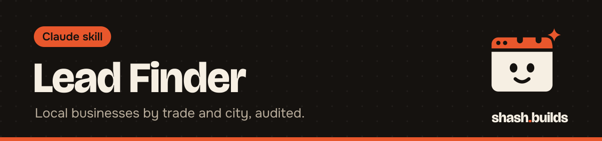

<p align="center"></p>

# Lead Finder

**Finds US service businesses by trade and city from public sources, audits each website, and writes a private CSV ranked with the weakest site first. Built for web designers and freelancers who sell to local businesses.**

This is step 1 of a four-skill sales kit: **lead-finder** -> [site-audit](../site-audit) -> [mock-builder](../mock-builder) -> [cold-email-drafter](../cold-email-drafter). The Master Skill's Sales head runs them in order, and each one also works alone.

## What it looks like

Example (made-up businesses, not real ones). Running `find_leads.py --trade plumber --city "Austin, TX" --limit 25 --out leads/austin-plumbers.leads.csv` writes a CSV like this:

```
business,trade,city,website,contact,score,problem_1,problem_2,problem_3,source
Demo Plumbing Co,plumber,"Austin, TX",https://demo-plumbing.example,contact page on website,82,The site is not set up for phones...,There is no tap-to-call or booking button...,The site shows signs of not being updated in years...,OpenStreetMap
Sample Pipe Works,plumber,"Austin, TX",,,,No website listed on OpenStreetMap. Search for the business before assuming it has none.,,,OpenStreetMap
```

The columns are `business, trade, city, website, contact, score, problem_1, problem_2, problem_3, source`. Scored rows come first, weakest site first. Rows with no score, such as a business with no listed website or a site whose robots.txt says no, come after them. The score is the [site-audit](../site-audit) score, where higher means a weaker site.

In the second made-up row, the website is blank, so it is not scored. That means the source did not list one. It does not prove the business has no site. Do a quick search before you call it "no website".

## Where the leads come from

- **Default: OpenStreetMap.** Nominatim finds the city and Overpass finds the businesses. It is free and needs no key. The data is open under the ODbL, so credit "© OpenStreetMap contributors" if you publish anything built on it. Coverage varies by city. Small towns can come back thin.
- **Optional: Google Places.** Use `--source places` with your own `GOOGLE_PLACES_API_KEY`. Google bills for it, so check your pricing. Follow Google's terms on storing results.
- **Never scrapes Google Maps** or any site whose terms forbid it.

The `contact` column is a public email from the source, or "contact page on website". Trades it knows: plumber, hvac, electrician, roofer, cleaner, landscaper, painter, carpenter, handyman, locksmith, pest control, salon, barber, dentist, auto repair, car wash, pet grooming, flooring.

## Keep your list private

A lead list is your work and it names real businesses. Never commit it or publish it. Save it under `leads/` or with a `.leads.csv` name, and make sure your `.gitignore` covers both. This repo's `.gitignore` already lists `leads/` and `*.leads.csv`. If you plan to send cold email, read the CAN-SPAM notes in [cold-email-drafter](../cold-email-drafter).

## Install in 3 steps

1. `/plugin marketplace add ShashwatBuilds/shash.builds`
2. `/plugin install lead-finder@shashbuilds`
3. Say "find 25 roofers in Tulsa, OK" and save the CSV under `leads/`.

Install [site-audit](../site-audit) too, because the audit step needs it next to this skill. Or pass `--no-audit` to skip it. On claude.ai: download `lead-finder-skill.zip` from [Releases](https://github.com/ShashwatBuilds/shash.builds/releases) and upload it under Settings, Capabilities. It runs a Python script, so it works best in Claude Code or anywhere Claude can run code. See [the skill file](skills/lead-finder/SKILL.md).

## Before and after

| Without the skill | With the skill |
| --- | --- |
| You copy business names from a map by hand | One command lists businesses for a trade and city |
| You guess which sites are worth a pitch | Each site is audited and the list is ranked weakest first |
| Lists end up in a public repo by accident | The CSV goes to `leads/` or `*.leads.csv`, which git ignores |
| "They have no website" is a hunch | A blank website is marked as "not listed", and Claude suggests a quick check |

## Examples

**Ask:** "Find 25 plumbers in Austin, TX."
**You get:** A CSV of businesses with website, contact, score and the top 3 problems, weakest site first.

**Ask:** "Find HVAC companies in Boise, ID with Google Places."
**You get:** The same CSV from Google Places using your key. Google bills for it.

**Ask:** "Find roofers in Tulsa, OK, no audit."
**You get:** A faster list with no scores (`--no-audit`).

## Requirements

- Python 3, standard library only.
- Internet access. No key for the default source.
- Your own `GOOGLE_PLACES_API_KEY` only if you use `--source places`.
- The [site-audit](../site-audit) skill next to this one, unless you pass `--no-audit`.

## FAQ

**Does it cost anything?** The skill is free and MIT licensed. OpenStreetMap is free. Google Places is billed by Google.

**Why are there so few results in my town?** OpenStreetMap coverage of small businesses varies by city. Try a bigger nearby city or the Google Places source.

**Is the list complete?** No. It shows what the source has. Treat it as a starting point.

**Can I share the list?** Keep it private. It holds business details you gathered for your own outreach.

## Changelog

- **1.0.0** (2026-11-03): first release in shash.builds.

---

Made by [shash.builds](../../README.md). Need a one-page website for your service business? [$400 flat, live in 7 days](../../README.md#hire-me).

MIT licensed, copyright Shashwat Jain. See [LICENSE.md](LICENSE.md).
