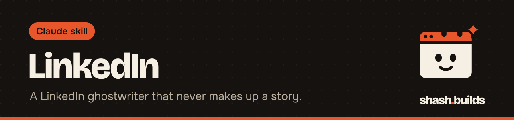

<p align="center"></p>

# LinkedIn

**A LinkedIn ghostwriter and editor for founders: it finds the post only you could write, writes the hook that works before "see more", and never invents a story.**

## What it looks like

Example:

```
You:    Write a LinkedIn post about the day our joggers started
        bagging at the knee.

Claude: Our joggers kept bagging at the knee by March. Every pair did.
        So we spent 8 months on the fabric. ...   [post, ready to paste]

        Fold preview: the lines a phone shows before "see more"
        Scores: Humanizer before to after, LinkedIn check errors
        and warnings, voice match
        Link: first comment, text provided
        Need from you: the real fabric weight and the mill name.
```

## Install in 3 steps

1. `/plugin marketplace add ShashwatBuilds/shash.builds`
2. `/plugin install linkedin@shashbuilds`
3. Ask: "Help me find a post to write this week." Claude asks for a few things you've written and what you want from LinkedIn.

On claude.ai: download `linkedin-skill.zip` from [Releases](https://github.com/ShashwatBuilds/shash.builds/releases) and upload it under Settings, Capabilities. Any chat: paste [the prompt](skills/linkedin/linkedin.md), with the [Humanizer prompt](../humanizer/skills/humanizer/humanizer.md) for the final edit.

## Before and after

| Claude without the skill | Claude with the skill |
| --- | --- |
| Opens with "I'm thrilled to announce" | Opens with the most surprising true thing, built for the fold |
| Invents a story to make the post land | Uses only what you tell it and asks when a detail is missing |
| Ends with "Agree?" and five hashtags | Skips engagement bait and keeps hashtags to a minimum |
| Ignores LinkedIn's limits | Checks length, fold, hook, format and bait with a script |

## Examples

**Ask:** "Turn this lesson about pricing into a post."
**You get:** a post draft, the fold preview, check results and a short list of facts it needs from you.

**Ask:** "Rewrite my headline and About section."
**You get:** versions checked against the 220 and 2,600 character limits.

**Ask:** "Reply to this comment and write a connection note to this founder."
**You get:** a short reply and a note under the length limit, with no pitch in the first line.

**Ask:** "Plan my posting for a month."
**You get:** a cadence and a set of post types based on your real material.

## Requirements

- Python 3 for the checker. Standard library only.
- The [Humanizer](../humanizer) skill is part of every job. Install it too. If it is missing, Claude edits by eye and tells you once how to add it.
- LinkedIn's limits change. Claude treats the numbers as right when written and says to check if a limit matters.

## FAQ

**Does it cost anything?** No. It's free and MIT licensed.

**Will it make up a story for me?** No. Every story, number, client and quote comes from you or your notes.

**Does it post for me?** No. You get text to paste.

**Where do links go?** The check flags links in the body. Claude tells you whether the link goes in the post or the first comment, and writes that comment.

**Does it use my own voice?** Yes. It compares drafts with posts you've written and moves toward them.

## Changelog

- **1.0.0** (2026-11-03): first release in shash.builds.

---

Made by [shash.builds](../../README.md). Need a one-page website for your service business? [$400 flat, live in 7 days](../../README.md#hire-me).

MIT licensed, copyright Shashwat Jain. See [LICENSE.md](LICENSE.md).
