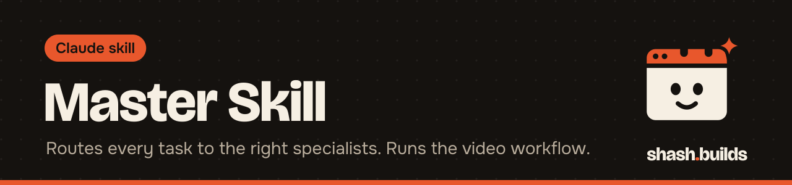

<p align="center"></p>

# Master Skill

**Sends each task to the one specialist that needs to handle it, and runs a full plan, build, review and fix workflow when you ask for a video.**

## What it looks like

Example:

```
You:    Make a 20 second Instagram reel about how UPI works.

Claude: Master: Design head, using the video workflow.
        Brief: 9:16, 20 s, one idea, voice-over plus captions.
        Built a draft, reviewed it as a buyer and as a motion designer,
        checked the sound, fixed the list, re-rendered.
        Delivered: upi-reel.mp4, plus the HTML source.
        Report: final score, before and after per criterion, open items,
        sound credits.
```

## Install in 3 steps

1. `/plugin marketplace add Shash-Builds/shash.builds`
2. `/plugin install master@shashbuilds`
3. Ask: "Make a 20 second reel that explains how UPI works."

On claude.ai: download `master-skill.zip` from [Releases](https://github.com/Shash-Builds/shash.builds/releases) and upload it under Settings, Capabilities. Any chat: paste [the prompt](../../dist/master-full.md).

## Before and after

| Claude without the skill | Claude with the skill |
| --- | --- |
| Writes one HTML or script draft and hands it over | Follows eight stages: brief, taste check, build, buyer review, motion review, fix plan, final render, delivery |
| Judges its own video by feel | Scores the video out of 100, fixes it and re-renders for up to 3 rounds until it reaches 85 |
| Loads every instruction for every question | Answers simple questions directly and loads a specialist only when the task needs one |
| Leaves sound as an afterthought | Mixes music and effects from a free sound library and prints the credit lines it needs |

## Examples

**Ask:** "Make a product video for my steel water bottle."
**You get:** the video file, the source, a scorecard before and after each fix round, and the buyer's biggest remaining objection.

**Ask:** "Write a LinkedIn post about our new pricing and review the pricing page."
**You get:** the LinkedIn skill writes the post, the Review head checks the page, and the Humanizer runs on the post before you see it.

**Ask:** "What is a good price for a 750 ml bottle?"
**You get:** a direct answer. No head is used for a simple question.

**Ask:** "Make Master task-specific."
**You get:** two or three lines on the two modes and the command to switch: `/plugin configure master@shashbuilds`.

## Requirements

- For video: Node with Playwright (Chromium) and ffmpeg, and Python 3. Claude checks for them and tells you what is missing.
- Sound effects and music come from a free library the skill downloads on request. Nothing is stored in this repo.
- The other shash.builds skills it hands work to are separate installs. If one is missing, Claude says how to add it and does the closest thing it can.

## FAQ

**Does it cost anything?** No. It's free and MIT licensed.

**Is it always running?** By default, yes, in Claude Code: a short router loads at the start of each session. Switch it to task-specific with `/plugin configure master@shashbuilds`, or say "Master Skill off" for one conversation.

**Which skills does it use?** Product, Ecom, Marketing, Design and Review heads call Competitor Research, Harsh Buyer Review, Social Media, LinkedIn, Humanizer, Motion Design Taste, Audio Review, Transcriber and others. Install the ones you want.

**Where do the files go?** Work happens in a scratch folder or your project folder, never inside the plugin. The video and its source files are handed back at the end.

**Does it use the Humanizer?** Yes, for anything public: posts, captions, listings, emails, scripts and replies.

## Changelog

- **1.0.0** (2026-11-03): first release in shash.builds.

---

Made by [shash.builds](../../README.md). See [everything I've built](../../README.md#everything-in-here).

MIT licensed, copyright Shashwat Jain. See [LICENSE.md](LICENSE.md).
