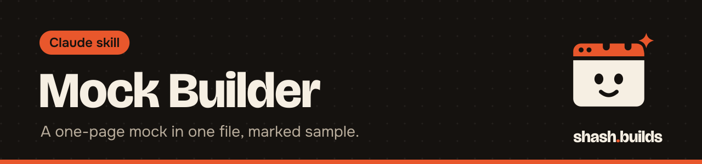
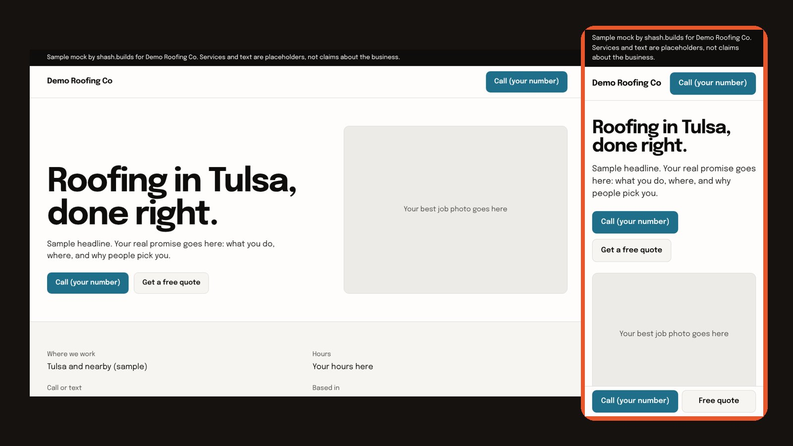

<p align="center"></p>

# Mock Builder

**Builds a one-page website mock for a local service business as a single HTML file, with every placeholder marked as sample and a link you can send. Built for web designers who would rather show a business owner a page than describe one.**

<p align="center"></p>

This is step 3 of a four-skill sales kit: [lead-finder](../lead-finder) -> [site-audit](../site-audit) -> **mock-builder** -> [cold-email-drafter](../cold-email-drafter). The Master Skill's Sales head runs them in order, and each one also works alone.

## What it looks like

Example. Running this command:

```
python3 mock.py --name "Demo Roofing Co" --trade "Roofing" --city "Tulsa" --state OK --by "shash.builds" --out previews/demo-roofing-co/index.html
```

writes one HTML file, with the CSS inside it, so it opens anywhere. The page has a sample banner, a headline, a call button, a quote button, a photo box, services, a reviews panel and a footer. On a phone, a call bar sticks to the bottom.

The banner reads: "Sample mock by shash.builds for Demo Roofing Co. Services and text are placeholders, not claims about the business." Keep it. The footer repeats that the mock is not affiliated with or approved by the business.

## The rules it follows

- **Public facts only.** Name, trade, city and state are enough. If the business has a public website, you may take its logo URL, main brand color and public phone number (`--logo`, `--color`, `--phone`). Nothing else about the business goes on the page.
- **No fake proof.** No reviews, ratings, years in business, licenses or awards unless you have the business's own public source. The reviews panel says real reviews go there.
- **Sample text is labeled.** The service list and the headline are placeholders, and each service carries a "Sample" tag.
- **Fixes what the audit found.** If a [site-audit](../site-audit) report exists, the mock should fix its top problems (call button, phone layout, service area) and Claude tells you which ones it fixes.
- **Hidden from search.** The page has `noindex`, so search engines skip it.

## Install in 3 steps

1. `/plugin marketplace add Shash-Builds/shash.builds`
2. `/plugin install mock-builder@shashbuilds`
3. Say "mock up a site for Demo Roofing Co, a roofer in Tulsa, OK".

On claude.ai: download `mock-builder-skill.zip` from [Releases](https://github.com/Shash-Builds/shash.builds/releases) and upload it under Settings, Capabilities. It runs a Python script, so it works best in Claude Code or anywhere Claude can run code. See [the skill file](skills/mock-builder/SKILL.md).

## Sharing a mock

Put every mock in one static site as `previews/<slug>/index.html` (a Netlify drop or GitHub Pages works) and share `https://<your-site>/previews/<slug>/`. Hand that link to [cold-email-drafter](../cold-email-drafter).

## Before and after

| Without the skill | With the skill |
| --- | --- |
| You tell an owner their site could be better | You send a page they can open on their phone |
| A mock with invented reviews and awards | Placeholders are labeled sample and the reviews panel stays empty |
| A design file that needs an app to open | One HTML file with the CSS inside |
| A mock that ignores what the audit found | The top audit problems are fixed, and you are told which |

## Examples

**Ask:** "Mock up a site for Demo Roofing Co, a roofer in Tulsa, OK."
**You get:** `previews/demo-roofing-co/index.html` and the link to share once it is hosted.

**Ask:** "Same, but use their brand color #1f6f8b and their public phone number."
**You get:** The call button in that color and a tap-to-call link to that number.

**Ask:** "Mock one up for each of the 5 weakest sites in leads/austin-plumbers.leads.csv."
**You get:** Five mocks, each fixing the top problems from its audit.

## Requirements

- Python 3, standard library only.
- A place to host static files if you want a link: Netlify drop or GitHub Pages both work.
- Only public facts about the business.

## FAQ

**Does it cost anything?** No. It's free and MIT licensed.

**Can I remove the sample banner?** Do not. It keeps the mock honest, because the page is not a claim about the business.

**Can it add real reviews?** Only if you give it the business's own public source. By default the panel says real reviews go there.

**Is it the finished site?** No. It is a mock to start a conversation. The real site needs the owner's photos, hours, services and reviews.

## Changelog

- **1.0.0** (2026-11-03): first release in shash.builds.

---

Made by [shash.builds](../../README.md). See [everything I've built](../../README.md#everything-in-here).

MIT licensed, copyright Shashwat Jain. See [LICENSE.md](LICENSE.md).
