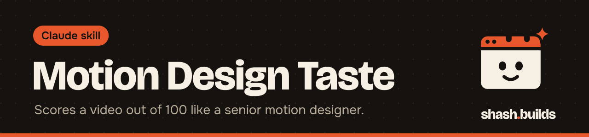

<p align="center"></p>

# Motion Design Taste

**Reviews a motion graphics video like a senior motion designer: it inspects the frames, scores it out of 100, ranks it against your references and lists exact fixes.**

## What it looks like

Example:

```
You:    Review reel.mp4 for Instagram. Compare it with ref.mp4.

Claude: Verdict: score out of 100, and the single biggest problem.
        What I inspected: specs, hook strip, contact sheets, frame
        strips at each scene change. Checks I could not do are listed.
        Scorecard (10 rows, each with timestamped evidence):
        Hook (first 3 s) | Clarity | Motion purpose | Timing and easing |
        Rhythm and sync | Typography | Layout | Colour | Audio | Mute+ending
        Ranking: reel.mp4 vs ref.mp4, with copyable techniques.
        Fix list, ranked by points gained: timestamp, evidence, exact
        change in frames or pixels, expected score change.
```

## Install in 3 steps

1. `/plugin marketplace add ShashwatBuilds/shash.builds`
2. `/plugin install motion-design-taste@shashbuilds`
3. Ask: "Review this video" and upload it, with any reference you like.

On claude.ai: download `motion-design-taste-skill.zip` from [Releases](https://github.com/ShashwatBuilds/shash.builds/releases) and upload it under Settings, Capabilities. Any chat: paste [the prompt](skills/motion-design-taste/motion-design-taste.md).

## Before and after

| Claude without the skill | Claude with the skill |
| --- | --- |
| Says the video looks good and could be punchier | Scores ten weighted criteria and ties each score to a timestamp |
| Watches nothing, or one frame | Builds a hook strip, contact sheets and frame-by-frame strips with ffmpeg |
| Suggests "make it more dynamic" | Gives exact changes: frames, pixels, easing, colour values, loudness target |
| Calls its own work fine | Re-renders after fixes, looks at the new frames and re-scores, up to three rounds |

## Examples

**Ask:** "Rank these three ad cuts."
**You get:** one score table, a head-to-head per criterion and the techniques the winner uses that the others do not.

**Ask:** "Fix the animation in this HTML video."
**You get:** the top fixes applied, a new render, and before and after scores. Script and brand look stay as they are.

**Ask:** "Why do viewers leave at 0:12?" (with a retention export)
**You get:** frames at each drop and fixes for the hook leak and the biggest cliff at the top of the list.

**Ask:** "This reference is great. Remember why."
**You get:** measured notes added to your taste notes, and a line telling you what was added.

## Requirements

- Python 3, plus ffmpeg and ffprobe for the inspection script. Without them, Claude follows a no-terminal path.
- Taste notes are saved in `taste/motion/taste-notes.md` in your project, or in the plugin's data folder.
- To apply fixes, Claude needs the source files. For someone else's video you get the fix list only.

## FAQ

**Does it cost anything?** No. It's free and MIT licensed.

**What are taste notes?** A file of your preferences learned from real videos. It overrides the general rules when they conflict.

**Does it change my script or brand look?** No. It fixes how things are done, not what you decided, unless you say so.

**How does it work with other skills?** The Master Skill's video workflow uses it for the review and fix rounds. Audio Review covers the sound in more depth.

**Can it judge any video?** It is built for motion graphics, ads, reels and explainers.

## Changelog

- **1.0.0** (2026-11-03): first release in shash.builds.

---

Made by [shash.builds](../../README.md). Need a one-page website for your service business? [$400 flat, live in 7 days](../../README.md#hire-me).

MIT licensed, copyright Shashwat Jain. See [LICENSE.md](LICENSE.md).
