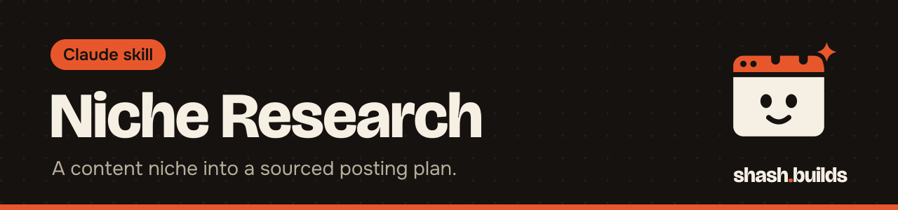

<p align="center"></p>

# Niche Research

**Researches a content niche and turns it into a posting plan: who already wins, which posts worked in the last 90 days and why, what the audience keeps asking, what nobody covers, 50 ranked video topics with hooks, when to post (ET) and the words people search. Every row has a source link and a date.**

## What it looks like

A real run, for this repo's own niche: [research/niche/shash-builds/report.md](../../research/niche/shash-builds/report.md).

```
You: Research my niche. I'm a solo web designer building one-page sites for US
service businesses with Claude, and I share free Claude skills. Audiences: owners
who need a site, and designers who want Claude skills. LinkedIn, Instagram reels,
YouTube, GitHub. Goal: leads.

Claude: Brief saved. Helpers on Haiku are collecting accounts, posts, audience
questions and search terms... (then verify, gaps, topics, report)

Answer: owners are burned by designers who take payment and go quiet (g-001), and
none of the 24 best posts speaks to them about it. First video: "Your website bill
doesn't end at launch. Here's the full year." (k-001)
Folder: research/niche/shash-builds/
```

What that run found, all in the report with links and dates: 33 accounts, the 24 best posts of the last 90 days, 63 audience questions and pains, 290 hashtags and search terms (259 straight from YouTube and Google search suggestions), 10 posting-time rows, 10 content gaps and 50 ranked topics.

## Install in 3 steps

1. `/plugin marketplace add Shash-Builds/shash.builds`
2. `/plugin install niche-research@shashbuilds`
3. Ask: "Research my niche" and give the niche, your audiences, your platforms and your goal.

On claude.ai: download `niche-research-skill.zip` from [Releases](https://github.com/Shash-Builds/shash.builds/releases) and upload it under Settings, Capabilities. Any chat: paste [the method](skills/niche-research/niche-research.md). Pick Haiku as the model to save credits.

## Before and after

| Without the skill | With the skill |
| --- | --- |
| "Top creators" from memory, with follower counts that may be a year old | Every count copied from the page, with its link and the date it was seen. Hidden counts say "hidden" |
| "Viral posts" from any year | Only posts from the last 90 days, each with its hook type, format, length and why it worked |
| Topic ideas that sound good | 50 topics scored demand x gap x fit by a script, each pointing to the questions and posts behind it |
| Hashtag lists from a blog | What people actually type, from YouTube and Google search suggestions |
| "Post at 9 am" | Posting slots per platform in ET, with the study behind each and a note when a study uses local time |
| Everything on the main model | Haiku helpers collect and verify; the main model only scores and writes the plan |

## Examples

**Ask:** "Quick research on the fitness coaching niche on Instagram."
**You get:** A Quick run: 10 accounts, 10 posts, 20 questions and 20 topics, with a report.

**Ask:** "What do people in my niche keep asking that nobody answers?"
**You get:** `voices.csv` and `gaps.csv`: questions quoted from comments, forums and review sites (never names), and the ones no top post covers.

**Ask:** "Give me 50 video ideas with hooks for YouTube Shorts."
**You get:** `topics.csv`, ranked, each with a hook under 12 words and its evidence.

**Ask:** "Now turn the top 10 into a calendar."
**You get:** The research is handed to the `social-media` skill, and LinkedIn posts to the `linkedin` skill.

## Requirements

- Claude Code with web search for the full helper run. Without helpers, Claude follows the same steps itself.
- Python 3 for `niche_ledger.py` and `suggest.py`.
- For YouTube: Node.js and Playwright with Chromium for `youtube_read.cjs`.

## FAQ

**Does it cost anything?** The skill is free and MIT licensed. It's built to run on Haiku to keep your Claude usage low.

**Does it log in or get around blocks?** No. It reads public pages at human pace. When a platform hides a number or blocks a page, the row says "hidden" or "blocked". Instagram, LinkedIn and Reddit often block logged-out reads, so expect fewer rows there.

**Does it collect people's data?** It quotes what people said and links the thread, but never records commenters' names or handles. Creators are listed by their public account.

**Does it write my posts?** No. It's research only. Hand the topics to the social-media or linkedin skill.

**Where do the files go?** `research/niche/<slug>/` in your project: the brief, seven CSVs, `tables.md` and `report.md`.

## Changelog

- **1.0.0** (2026-11-03): first release in shash.builds.

---

Made by [shash.builds](../../README.md). See [everything I've built](../../README.md#everything-in-here).

MIT licensed, copyright Shashwat Jain. See [LICENSE.md](LICENSE.md).
