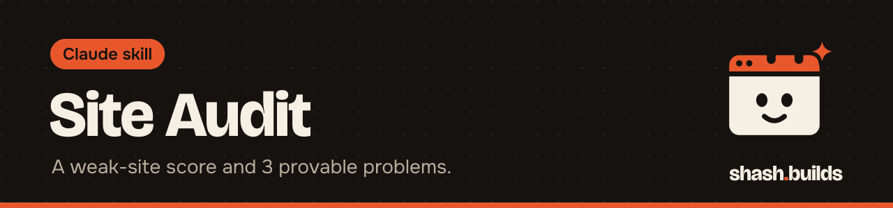

<p align="center"></p>

# Site Audit

**Scores how weak a small business website is, from 0 to 100, and names the 3 most specific problems an owner would care about, each with its proof. Built for anyone about to pitch a website to a local business.**

This is step 2 of a four-skill sales kit: [lead-finder](../lead-finder) -> **site-audit** -> [mock-builder](../mock-builder) -> [cold-email-drafter](../cold-email-drafter). The Master Skill's Sales head runs them in order, and each one also works alone.

## What it looks like

Example (made-up business). Running `audit.py https://demo-plumbing.example --name "Demo Plumbing Co" --md audit.md` writes this report:

```
# Site audit: Demo Plumbing Co

Checked 2026-11-03T15:00:00Z by shash.builds site-audit.

**Weak-site score: 82/100** (higher means more room to improve)

## Top problems

1. The site is not set up for phones, so on a phone it shows as a tiny desktop page.
   Evidence: No <meta name="viewport" content="width=device-width..."> tag
2. There is no tap-to-call or booking button, so a visitor on a phone has to copy the number by hand.
   Evidence: No tel: link and no link or button that says call, book, schedule, quote or estimate
3. The site shows signs of not being updated in years, which makes the business look closed or behind.
   Evidence: Found: font, copyright 2019

## Also found

- The homepage shows no customer reviews, so a new visitor has no proof the business is good.
- The homepage never says which towns the business serves, so locals can't tell if it covers them.

Fetched: https://demo-plumbing.example/robots.txt, https://demo-plumbing.example
```

The business, the URL and the numbers above are made up to show the format. A real run reports what it measured on the real page.

**How to read the score.** It runs from 0 to 100, and higher means a weaker site, which makes it a better prospect for a rebuild. Each problem adds a fixed weight and the total is capped at 100. A score under 30 means the site is already in decent shape. Every problem comes with the evidence that proves it, and the top 3 are the heaviest ones.

**What it fetches.** It reads `robots.txt`, then the one page you name. Unless you pass `--no-links`, it also sends HEAD requests to at most 15 links found on that page to look for broken ones. Nothing else. If `robots.txt` disallows the page, it stops, says so in the `skipped` field, and does not audit. Respect that and do not work around it. If the business has no site, pass `none` and it reports that.

It uses only the Python 3 standard library.

## Install in 3 steps

1. `/plugin marketplace add ShashwatBuilds/shash.builds`
2. `/plugin install site-audit@shashbuilds`
3. Say "audit this site: https://their-site.com".

On claude.ai: download `site-audit-skill.zip` from [Releases](https://github.com/ShashwatBuilds/shash.builds/releases) and upload it under Settings, Capabilities. It runs a Python script, so it works best in Claude Code or anywhere Claude can run code. See [the skill file](skills/site-audit/SKILL.md).

## Before and after

| Without the skill | With the skill |
| --- | --- |
| "Their site looks old" is a feeling | Each problem is a plain sentence with the evidence next to it |
| You click around a site for 20 minutes | One command checks https, phone layout, call button, speed, reviews, service area, broken links, Google profile and page title |
| You might quote a problem that is not there | It reports only what it measured and never fills 3 slots with a guess |
| A pitch that sounds like every other cold email | The audit gives one specific, provable line the owner can check in 10 seconds |

## Examples

**Ask:** "Audit https://their-site.com and give me the top 3 problems."
**You get:** The score and 3 one-sentence problems an owner understands, each with its evidence. Download time is from the audit server, not a phone, and Claude says so when it quotes it.

**Ask:** "This plumber has no website. Audit them."
**You get:** A score of 100 and one problem: no website, so people who search for the business find only directory listings.

**Ask:** "Audit this site but skip the link check."
**You get:** The same report from the one page and `robots.txt` only, with no HEAD requests (`--no-links`).

**Ask:** "Is this site outdated?"
**You get:** A yes only if something visible backs it up, such as an old copyright year or old tags. A design opinion with no proof is left out.

## Requirements

- Python 3, standard library only. No account and no API key.
- Internet access to reach the site you audit.

## FAQ

**Does it cost anything?** No. It's free and MIT licensed.

**Is it allowed to fetch the page?** It checks `robots.txt` first and stops if the page is disallowed. It sends a user agent that names this repo. It fetches one page and at most 15 link checks.

**Is the speed number from a phone?** No. It is the download time from the machine running the audit. Treat it as a rough signal.

**Can it miss problems?** Yes. It checks a fixed list. A site with a clean score can still have problems the script does not test for, and a site can score high for a reason you would call fair. Read the evidence before you send anything.

**Does it work with the rest of the kit?** Yes. [lead-finder](../lead-finder) runs it on every business it finds. Its JSON tells [mock-builder](../mock-builder) what to fix and gives [cold-email-drafter](../cold-email-drafter) the one personal line.

## Changelog

- **1.0.0** (2026-11-03): first release in shash.builds.

---

Made by [shash.builds](../../README.md). Need a one-page website for your service business? [$400 flat, live in 7 days](../../README.md#hire-me).

MIT licensed, copyright Shashwat Jain. See [LICENSE.md](LICENSE.md).
