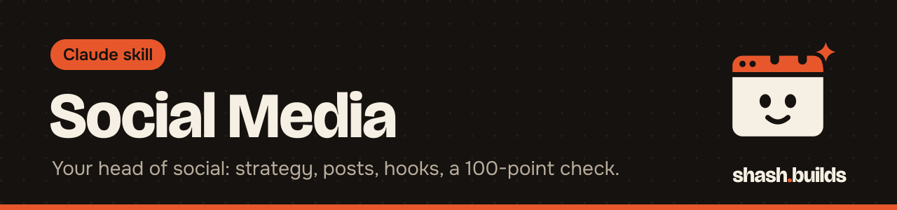

<p align="center"></p>

# Social Media

**Turns Claude into a head of social media for founders: strategy, calendars, posts, hooks, reel scripts and analytics, with every piece scored before you post it.**

## What it looks like

Example:

```
You:    Write an Instagram reel about why our joggers cost Rs 999.

Claude: Social: create, Instagram reel.

        Hooks (recommended first):
        1. "We lost money on our first 200 pairs. Here's the maths."
        2. ...
        Script table, caption, on-screen text, hashtags, cover text,
        alt text, posting notes.

        Scorecard (out of 100):
        Hook stopping power 8, Payoff 7, Shareability 6, Clarity 8,
        Proof 7, Native to platform 8, Brand voice 7, CTA 8,
        Human writing 8, Compliance 10.
        Five seats: a stranger, a customer, a competitor, ...
        What to test: hook type. Log it after posting.
```

## Install in 3 steps

1. `/plugin marketplace add ShashwatBuilds/shash.builds`
2. `/plugin install social-media@shashbuilds`
3. Ask: "Plan my next 2 weeks of Instagram posts." Claude asks about your brand, audience and goal the first time.

On claude.ai: download `social-media-skill.zip` from [Releases](https://github.com/ShashwatBuilds/shash.builds/releases) and upload it under Settings, Capabilities. Any chat: paste [the prompt](skills/social-media/social-media.md).

## Before and after

| Claude without the skill | Claude with the skill |
| --- | --- |
| Writes a generic caption with hashtags | Starts from one idea, writes several hooks and marks the best |
| Tells you the post is great | Scores it on a 100-point scorecard and ships only at 80 or above, with no weak criterion |
| Forgets your brand between chats | Reads and saves brand memory: voice, audience, pillars |
| Guesses what worked | Analyses your post log with a script, by pillar, format and hook type |

## Examples

**Ask:** "Make a 30 day content calendar for my D2C brand."
**You get:** a calendar built on your pillars and goal, with the three most important actions for this week.

**Ask:** "Review this carousel before I post."
**You get:** a scorecard, five reader reactions and a fix list.

**Ask:** "Turn this YouTube video into a LinkedIn post and three Shorts ideas."
**You get:** versions made for each platform, not copies.

**Ask:** "Which of my posts worked?" (a CSV of your posts)
**You get:** a report on which pillars, formats and hook types did best, from your own data.

## Requirements

- Python 3 for the analytics and hook scoring scripts. Standard library only.
- A web search tool helps for trends. Without it, Claude says what it could not check.
- Nothing is published for you. Every piece ends in a block you copy.

## FAQ

**Does it cost anything?** No. It's free and MIT licensed.

**Which platforms?** Instagram, TikTok, YouTube, LinkedIn, X and more. The platform guide covers specs for each.

**Where is my brand memory saved?** In a `social/` folder in your project if you work in one, otherwise in the plugin's data folder. Never inside the plugin itself.

**Does it promise viral posts?** No. It follows honest growth rules and runs a compliance and honesty check before anything goes out.

**How does it work with other skills?** It uses Humanizer for the final edit, Harsh Buyer Review for posts that sell, Motion Design Taste to review videos, and the Master Skill to produce them.

## Changelog

- **1.0.0** (2026-11-03): first release in shash.builds.

---

Made by [shash.builds](../../README.md). Need a one-page website for your service business? [$400 flat, live in 7 days](../../README.md#hire-me).

MIT licensed, copyright Shashwat Jain. See [LICENSE.md](LICENSE.md).
