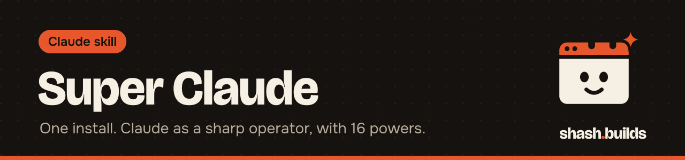

<p align="center"></p>

# Super Claude

**One install that makes Claude work like a sharp operator in every session. It talks before it acts, sends grunt work to cheap helpers, checks everything three times, remembers your decisions, and loads one of 16 powers only when a task needs it.**

## What it looks like

```
You: Find me 10 founder's office roles I can email, under 2 years' experience.

Claude: Plan: 3 helpers search founder posts and job boards from the last 14 days, I open every
listing, drop internships and anything that asks for 2+ years, and keep only posts with an email.
Go?

You: Go

Claude: [3 helpers on Haiku read 236 posts in parallel, Claude checks each one]
Here are the 7 that pass, with the email shown on each post. Drafts below, one copy block each.

Super Claude: career, writer. 3 helpers on Haiku.
```

## The four modes (always on)

| Mode | What it does |
|---|---|
| Talk first | Plans in a few short lines and waits for "go" on anything new, big, public or paid |
| Economy | Cheap helpers read, search and screen in parallel; the main model judges, writes and checks |
| Careful | Right, complete, what could go wrong: three checks before anything goes out |
| Memory | Searches `memory/memory.csv` before asking and saves every decision the moment it is made |

## The 16 powers

| Power | For | Builds on |
|---|---|---|
| Video Studio | Reels, explainers, edits, voice, captions, music | master video workflow, motion-design-taste, audio-review, transcriber, clipper |
| Writer | Posts, emails, scripts, bios, replies | humanizer, linkedin, comment-drafter |
| Social | Plans, hooks, analytics, "why no views" | social-media, niche-research |
| Research | Competitors, markets, any sourced answer | competitor-research |
| Sales | Local-business leads, audits, sample sites, cold email | lead-finder, site-audit, mock-builder, cold-email-drafter |
| Career | Roles, CVs, applications, follow-ups, offers | ai-resume |
| Ecom | Listings, images, fees, margins | ecom |
| Amazon Ads | Search terms, negatives, bids, the Ads API | ecom |
| Clipping | Paid clipping campaigns, Shorts | clipper |
| Reviewer | Scores, ranked fixes, second opinions | harsh-buyer-review, brutal-review |
| Visuals | AI images and video prompts | ai-visuals |
| Web | Sites, landing pages, deploys | mock-builder |
| Operator | Multi-day projects, handovers, backups | agent-team, economy-mode |
| Numbers | Pricing, budgets, offers, forecasts | (code, always) |
| Docs | Docs, sheets, decks, link lists | (connected tools) |
| Helper | Fixing a device one step at a time | (plain steps) |

## Install in 3 steps

1. `/plugin marketplace add Shash-Builds/shash.builds`
2. `/plugin install super-mode@shashbuilds`
3. Start a new session. The core loads by itself; switch it to task-specific in the plugin's settings if
   you only want it when you ask.

Easiest of all: paste the repo link into Claude and say "set me up". On claude.ai, upload
`super-mode-skill.zip` from the latest GitHub Release.

## FAQ

**Do I still need the other skills?** Super Claude works alone. Each power uses the matching skill when it
is installed and reads its prompt from this repo when it isn't. Installing the skills you use most makes
those powers stronger.

**Does it cost more?** The core is under 450 words; powers load only when a task needs them, and helpers
run on cheaper models.

**Will it post or pay for me?** Never. It prepares; you press send.

## Changelog

- 21 Nov 2026: first release, 4 modes and 16 powers.
