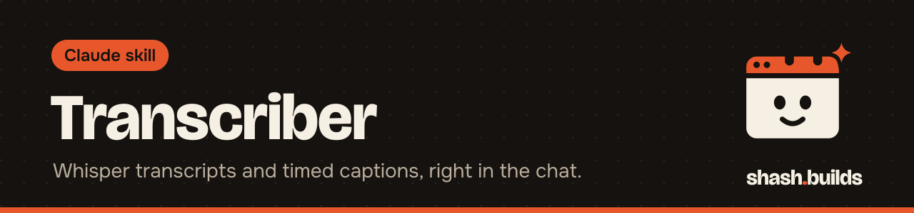

<p align="center"></p>

# Transcriber

**Upload a voice note, podcast, call or video and get a transcript and timestamped captions, made with OpenAI's Whisper inside the chat.**

## What it looks like

Example:

```
You:    Transcribe this voice note. It's Hinglish.  [uploads note.m4a]

Claude: [full transcript, Hindi in Roman letters, English words kept,
        doubtful words marked]
        Language: Hindi. Duration: as detected.
        Files: note.txt, note.srt, note.vtt, note.json (word timings)
        Next: captions for a reel, a post in your voice, YouTube chapters.
```

## Install in 3 steps

1. `/plugin marketplace add ShashwatBuilds/shash.builds`
2. `/plugin install transcriber@shashbuilds`
3. Ask: "Transcribe this" and upload the file.

On claude.ai: download `transcriber-skill.zip` from [Releases](https://github.com/ShashwatBuilds/shash.builds/releases) and upload it under Settings, Capabilities. Any chat: paste [the prompt](skills/transcriber/transcriber.md).

## Before and after

| Claude without the skill | Claude with the skill |
| --- | --- |
| Says it cannot listen to audio | Runs Whisper in its own sandbox and returns the text |
| Hindi comes out in Devanagari, English words garbled | A Hinglish option writes Hindi in Roman letters and keeps English words in English |
| Guesses names and numbers | Marks doubtful words and lets you pass brand names as hints |
| Gives text only | Writes .txt, .srt, .vtt and a .json with word timings |

## Examples

**Ask:** "Transcribe my call recording and pull out the action items."
**You get:** the transcript, then the list. Claude checks you have consent before you share a recording of other people.

**Ask:** "Make captions for this reel."
**You get:** an .srt file you can upload or burn into the video.

**Ask:** "Translate this Tamil voice note to English."
**You get:** an English translation of the speech.

**Ask:** "Transcribe this with the most accuracy you can. It has prices in it."
**You get:** the larger model, which handles numbers and names better, with the cost of a bigger first download.

## Requirements

- Python 3.9 or newer. The script installs faster-whisper on first use.
- Internet on the first run, to fetch the engine and the model. Later runs reuse them.
- ffmpeg helps with decoding but is not required.
- The audio stays in the sandbox. If packages cannot be installed, Claude lists phone options such as Voice Memos transcripts or YouTube auto-captions.

## FAQ

**Does it cost anything?** No. It's free and MIT licensed. Whisper runs in the chat's sandbox, so there is no separate API bill.

**Where do the files go?** The script writes them to a folder Claude chooses. Where the chat allows it, they are offered as downloads.

**How accurate is it?** Whisper mishears names, brands, numbers and mixed languages. The default model suits clear English drafts. Use the larger one for Hindi, numbers, noisy audio or anything you will quote.

**Which models?** `base` (default) and `small` come from verified shash.builds packages once they're published. `medium` and `large-v3` (`--size medium`) are more accurate and are downloaded by faster-whisper from Hugging Face (about 1.5 GB and 3 GB), so they need a sandbox or computer that can reach it.

**Which languages?** English, Hindi, Hinglish and 90+ languages.

**What can I do with the transcript?** The Master Skill can rough-cut a video from it, and Social Media can make chapters, Shorts picks and posts.

## Changelog

- **1.1.0** (2026-11-03): `--size medium` and `large-v3`, `--max-chars` for shorter caption lines, split words joined ("one -page" is now "one-page"), cues never pass the width limit. The Toolbox's transcribe tool uses this engine.
- **1.0.0** (2026-11-03): first release in shash.builds.

---

Made by [shash.builds](../../README.md). Need a one-page website for your service business? [$400 flat, live in 7 days](../../README.md#hire-me).

MIT licensed, copyright Shashwat Jain. See [LICENSE.md](LICENSE.md).
