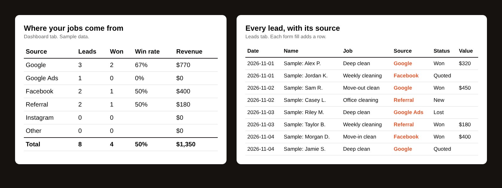

# Lead Tracker

**Every form fill on a website lands in a Google Sheet with where the visitor came from: Google, Google Ads, Facebook, Instagram, AI search, a referral or direct. A Dashboard tab shows leads, wins, win rate and revenue by source.**

Free. No paid tools, no monthly fee. A Google account and a website are all you need.

## Install in 3 steps

1. **Sheet:** upload [`lead-tracker-demo.xlsx`](lead-tracker-demo.xlsx) to Google Drive and open it with Google Sheets. Delete the sample rows.
2. **Receiver:** in the Sheet, Extensions, then Apps Script. Paste [`apps-script.gs`](apps-script.gs), save, then Deploy, New deployment, Web app, Execute as: Me, Who has access: Anyone. Copy the web app URL.
3. **Website:** paste that URL into [`capture.js`](capture.js) where it says `PASTE_WEB_APP_URL_HERE`, add `` to the page, and give the form `id="quote-form"` with fields named `name`, `phone`, `email` and `job`.

Send a test lead. It shows up in the Leads tab with its source. About 30 minutes the first time.

Using [One-Page Starter](../one-page-starter)? Skip step 3: pass `--sheet-url` and it wires the form for you.

## Before and after

| Before | After |
| --- | --- |
| "We get leads from... Google, I think?" | A table of leads, wins and revenue for each source |
| Form fills scattered across an inbox | One row per lead, with date, job, source, page and status |
| Ad money spent on a guess | Win rate and revenue per source, so you see what pays |

## Examples

- A cleaner sees Google brings most jobs and Facebook brings the biggest ones, and moves ad money.
- A web designer adds this to every client site and shows the client the Dashboard at the monthly check-in.
- A landscaper marks each lead Won or Lost with a job value, and the Dashboard updates by itself.

## How the source is worked out

`capture.js` checks, in order: a `gclid` or `utm_source=google_ads` (Google Ads), any other `utm_source`, then the referring site (Google, Facebook, Instagram, ChatGPT or Perplexity as AI search). No referrer means Direct. It remembers the first source per visitor, so a second visit doesn't overwrite it.

## FAQ

**What can't it track?** Phone calls (that needs a paid call-tracking number). Some apps hide the referrer, so a few real Google or social visits show as Direct.

**Is the data private?** It goes straight from the website to the owner's own Google Sheet. Nothing passes through anyone else's server.

**Do I need to code?** You paste two snippets and change one line. The steps above are all of it.

**Is there a limit?** Google Apps Script quotas are generous for a small business's form traffic.

## Changelog

- **1.0.0** (2026-11-03): first release.

---

Made by [shash.builds](../../README.md). Need a one-page website for your service business? [$400 flat, live in 7 days](../../README.md#hire-me).

MIT licensed, copyright Shashwat Jain.
