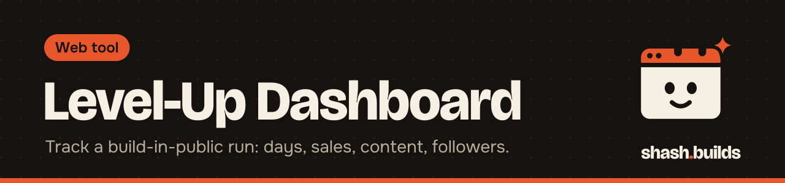
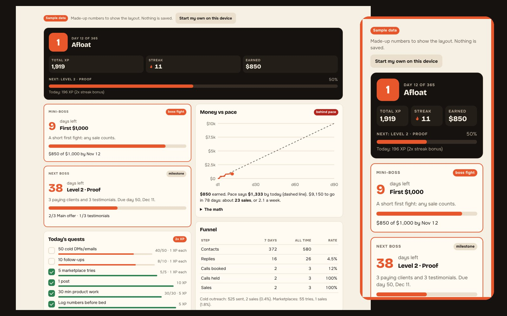

# Level-Up Dashboard

**Turn your 365-day business goal into a game you log every night: levels, boss fights, daily quests, XP, streaks and money against your pace.**

Sample data. <a href="https://shash-builds.github.io/Shash.builds/docs/level-up-game/#sample">Try the sample</a> (nothing is saved).

Three pieces, one idea. Pick the one that fits:

| Piece | What it is | Where your data lives |
| --- | --- | --- |
| **[Level-Up Game](game/level-up-game.html)** (main) | The full game: levels with deadlines, boss fights, daily quests, XP, streaks, money against pace, an optional 15-day plan you tick off, funnel, revenue, content log and a Sunday review. One HTML file with a `CONFIG` block. | Your own private Claude artifact (best), or this browser with Export and Import |
| **Phone logger** ([`docs/level-up/`](../../docs/level-up/index.html)) | A lighter page to log the day from your phone, with tap counters, networking quests and a Network card. | Your Google Sheet, through the script in [`apps-script/`](apps-script/Code.gs), behind a passphrase |
| **Sheet template** (below) | The Google Sheet the phone logger reads and writes. | Your Google Drive |

## Level-Up Game

### Install in 3 steps

1. **With the skill (easiest):** install [`SKILL.md`](SKILL.md) as a Claude skill (or paste it into a chat with `game/level-up-game.html`). Tell Claude your goal, what you sell and your daily habits.
2. Claude fills in the `CONFIG` block at the top of the file. Your top level is named after the role model you chase. It's a label only: never a real person's likeness or brand.
3. Claude publishes it as your own private artifact with storage turned on. Or open the file in any browser: it saves on that device only, with Export and Import for backups.

Live now while GitHub Pages serves the repo root: [sample](https://shash-builds.github.io/Shash.builds/docs/level-up-game/#sample). If Pages is switched to the `/docs` folder, drop `/docs` from the address.

Want to see it first? Open the page with `#sample` at the end of the address. The numbers are made up and nothing is saved.

### What you can change in `CONFIG`

`roleModel`, `plan` (the 15-day plan panel: `enabled`, `title`), `startDate` (empty means the day you first open it), `totalDays`, `timezone`, `currency`, the money goal and its pace, a `miniBoss`, `products`, `channels`, `counters`, `quests`, the `xp` rules, the `funnel` steps, and the `levels`. Each level has a day it's due and `needs`, which must all be met: `flags`, `sales`, `total`, `bestMonth`, `productSales`, `counter` or `followers`.

[`game/examples/one-page-studio.config.js`](game/examples/one-page-studio.config.js) is a filled example for a one-page website studio, the setup shash.builds uses, with personal targets removed.

## Phone logger and Sheet

- **The Sheet template** (below): where your numbers live.
- **The app** ([`docs/level-up/`](../../docs/level-up/index.html)): a phone-first page to log your day and see your level, XP, streak, and money against your pace. It talks to your Sheet through a small script you paste into it ([`apps-script/Code.gs`](apps-script/Code.gs)), protected by a passphrase you choose.

Your goals, pace and XP weights live in the Sheet's `config` tab, not in code, so anyone can set their own target and chase it.

## The Sheet template

Six tabs, one header row each, frozen and styled. Nothing else to set up.

| Tab | One row per | Columns |
| --- | --- | --- |
| `days` | day | date, day, hours_worked, shipped, outreach_sent, replies, calls_booked, posts_published, notes, invites_sent, invites_accepted, comments, follows, inbound_dms, owner_replies |
| `sales` | payment | date, client, offer, amount_usd, status (deposit, paid, refunded), source, notes |
| `content` | post | date, platform, format, title, url, views, likes, comments, shares, saves |
| `followers` | check-in | date, instagram, youtube, linkedin, x, github_stars |
| `reviews` | real review | date, client, platform, rating, quote, permission_to_share (yes, no), url |
| `config` | setting | key, value, notes: start_date, goal_usd, offer_price_usd, timezone, currency |

## Install in 3 steps

1. **[Make a copy of the Google Sheet](https://docs.google.com/spreadsheets/d/14H1zb1JAfK5d10UuI4kJBvFVKrOCVYIU_aScMdlTp5A/copy)** (you need a Google account).
2. Set your `start_date` and `goal_usd` in the `config` tab.
3. Add a row to `days` every evening.

No Google account? Download [`sheet-template/level-up-dashboard.xlsx`](sheet-template/level-up-dashboard.xlsx) and open it in Excel or any spreadsheet app.

Prefer plain files? Each tab is also a CSV in [`sheet-template/`](sheet-template).

## The app in 4 steps

1. In your copy of the Sheet: Extensions, then Apps Script. Paste [`apps-script/Code.gs`](apps-script/Code.gs) and save.
2. Project Settings, then Script Properties: add `PASSPHRASE` with a long phrase only you know.
3. Deploy, then New deployment, then Web app (Execute as: Me, Who has access: Anyone). Copy the `/exec` URL.
4. Open the app ([shash-builds.github.io/Shash.builds/docs/level-up/](https://shash-builds.github.io/Shash.builds/docs/level-up/), or host `docs/level-up/index.html` yourself), paste the URL and passphrase, and tap Unlock.

Every read and every write needs the passphrase, so the URL alone shows nothing. The URL and passphrase are saved only on your device.

**How the game works.** The rules live in [`docs/level-up/config.json`](../../docs/level-up/config.json), so a fork can change everything. Any key in the Sheet's `config` tab overrides it (`goal_usd`, `goal_days`, `start_date`, or per counter `xp_<key>`, `quest_<key>`, `cap_<key>`).

| Counter | XP | Daily quest |
| --- | --- | --- |
| Invites sent (LinkedIn, with a "building in public" note) | 1 each | 15 |
| Comments on target posts | 2 each | 10 |
| Follows of target accounts | 1 each, max 10 XP a day | 5 |
| Posts published | 10 each | 1 |
| Emails sent | 2 each | |
| Owner replied (a business owner accepted and replied) | 10 each | big win |
| Email replies | 5 each | |
| Inbound DMs from potential clients | 25 each | big win |
| Calls booked | 25 each | big win |
| Hours worked | 10 an hour | |
| Shipped something | 25 | |
| Money earned | 0.5 per dollar | |

Level 1 needs 100 XP, and each level after needs 50 more. A streak counts consecutive logged days. Pace spreads `goal_usd` evenly over `goal_days` from `start_date`. The Network card shows the acceptance rate, comments and inbound DMs in the last 7 days, and the funnel from invites to accepted to owner replies to calls.

If your Sheet is missing a column the app sends, the script adds it at the end of the tab.

## Rules that keep it honest

- Numbers come from each platform's own analytics or your bank, never from memory.
- A review goes public only when `permission_to_share` is `yes`.
- Client names stay in your copy. Don't publish the `sales` tab.

## FAQ

**Why a Sheet?** It's free, it works on a phone, and you can share it read-only with anyone, or with an assistant.

**Can I add columns?** Yes. Add them at the end of a tab so anything that reads the headers keeps working.

## Changelog

- **0.4.0** (2026-11-04): optional 15-day plan panel (tick tasks off, no XP), with an editor to add a day.
- **0.3.0** (2026-11-04): the Level-Up Game (one config block, Claude artifact or browser storage, sample mode), its skill and an example config.
- **0.2.0** (2026-11-03): the phone logger (daily log with tap counters and quests, level, XP, streak, money vs pace, Network card) and the Apps Script API.
- **0.1.0** (2026-11-03): the Sheet template.

---

Made by [shash.builds](../../README.md). Need a one-page website for your service business? [$400 flat, live in 7 days](../../README.md#hire-me).

MIT licensed, copyright Shashwat Jain.
