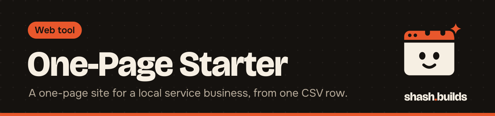
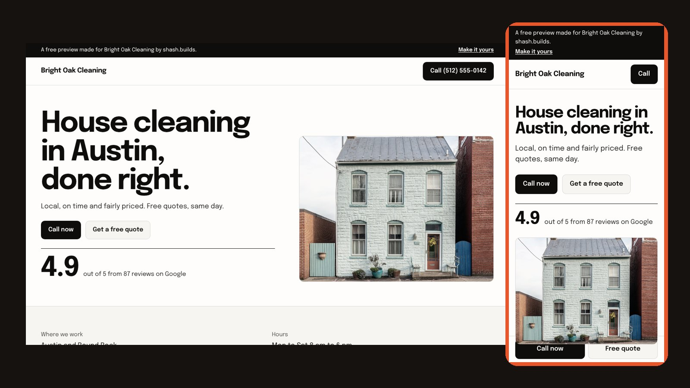

<p align="center"></p>

# One-Page Starter

**Turn one row of a spreadsheet into a fast one-page website for a local service business: name, call button, services, hours, service area, Google rating, real reviews and a quote form.**

<p align="center"></p>

See the built sample: [`demo/sample-cleaning/index.html`](demo/sample-cleaning/index.html) (download and open it, or deploy the folder).

## Install in 3 steps

1. Copy this folder, or `git clone https://github.com/ShashwatBuilds/shash.builds` and `cd tools/one-page-starter`.
2. Fill a CSV with the columns in [`sample.csv`](sample.csv), one row per business.
3. Run `python3 build.py businesses.csv out`. Each business gets `out/<slug>/index.html`. Drag the folder onto [Netlify Drop](https://app.netlify.com/drop) or any static host.

Python 3 only. No packages, no build step, no framework.

## Before and after

| Before | After |
| --- | --- |
| A Facebook page, a dead link, or a slow builder template | One clean page that loads fast on a phone |
| Phone number buried in a footer | A call button in the header and a sticky call bar on phones |
| Reviews nobody sees | The business's Google rating set big, with three real reviews |
| A contact form that emails nobody | A quote form that drops each lead in a Google Sheet with its source (with [Lead Tracker](../lead-tracker)) |

## Examples

**A live site for a client, with working leads:**

```bash
python3 build.py clients.csv out --sheet-url "https://script.google.com/macros/s/YOUR_ID/exec"
```

The quote form turns on and posts every request to the client's sheet. Set up the sheet with [Lead Tracker](../lead-tracker) first.

**Previews to show prospects before they pay** (what Shashwat does for outreach):

```bash
python3 build.py prospects.csv out --by "Your Studio" --by-url "https://your-site.com"
```

Each page gets a slim ribbon: "A free preview made for <business> by Your Studio. Make it yours." The form stays off.

**CSV columns:** `slug, name, trade, city, state, phone, rating, reviews_count, services` (separated by `|`), `hours, area, review1, review1_by` (up to 3 reviews), `photo_url, photo_credit, sample`. Set `sample` to `yes` to label the page as sample data.

## FAQ

**Can I use it for client work?** Yes. It's MIT licensed. Sell the sites, keep the money.

**Where do the reviews come from?** From the business's own public Google reviews, copied by you. Use real ones only, and only the business's own.

**What about the photo?** Put the business's own photo URL in `photo_url` and credit it in `photo_credit`. Without one, a credited Wikimedia Commons stand-in is used.

**Can I change the design?** Edit `tokens.css` for colors, fonts and spacing, and `page.css` for layout. The design passed the Hallmark checks (no stock-template tells, accessible focus states, reduced-motion safe).

**Fonts?** Epilogue from Google Fonts (SIL Open Font License).

## Changelog

- **1.0.0** (2026-11-03): first release. `--by` preview ribbon and `--sheet-url` live form.

---

Made by [shash.builds](../../README.md). Need a one-page website for your service business? [$400 flat, live in 7 days](../../README.md#hire-me).

MIT licensed, copyright Shashwat Jain. Stand-in photo credit is printed on every page.
