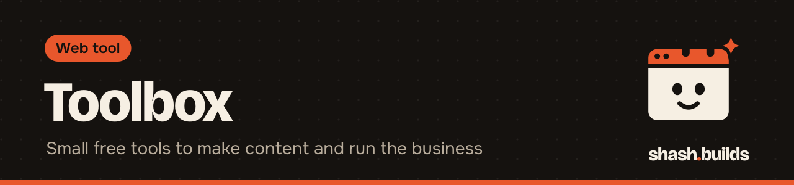

<p align="center"></p>

# Toolbox

**The small tools shash.builds uses every day to make content and run the business.** Each one runs on your own computer (Windows, macOS, Linux) with free, open-source dependencies. No paid APIs, no keys.

Every tool is a folder with its own README, a command-line script and a `SKILL.md`, so Claude can run it for you.

| # | Tool | What it does | Status |
| --- | --- | --- | --- |
| 1 | [transcribe](transcribe) | Audio or video to transcript, SRT and VTT captions, word timestamps (local Whisper, English, Hindi, Hinglish) | 0.1.0 |
| 2 | [cut-silence](cut-silence) | Removes silences and "umm" gaps from a face recording, keeping a 0.15 s pad (ffmpeg only) | 0.1.0 |
| 3 | [video-build](video-build) | A day's `video.md`, voice and face clip to a 1080x1920 reel with brand captions, on-screen text and music, -14 LUFS | 0.1.0 |
| 4 | repurpose | Transcript to LinkedIn post, Instagram caption, X thread, YouTube title and chapters | building |
| 5 | photo-kit | Background removal, every platform size, compression, EXIF and GPS stripped | building |
| 6 | thumb-maker | YouTube and reel covers from a title and a face cutout | next |
| 7 | carousel-maker | Markdown to Instagram and LinkedIn carousel PNGs and PDF | next |
| 8 | site-snap | URL to full-page and mobile screenshots plus Lighthouse scores | next |
| 9 | og-favicon | One logo to a favicon set, apple-touch icon, OG image and web manifest | next |
| 10 | invoice | Client and items to a PDF invoice with a payment-link field | next |
| 11 | utm-link | Tracked links for every channel, so you know which one brought each call | next |

## Install everything

macOS or Linux:

```bash
bash tools/toolbox/install.sh
source tools/toolbox/.venv/bin/activate
```

Windows (PowerShell), untested on Windows yet:

```powershell
powershell -ExecutionPolicy Bypass -File tools\toolbox\install.ps1
.\tools\toolbox\.venv\Scripts\Activate.ps1
```

The installer adds ffmpeg and Python if they're missing (Homebrew, apt or dnf, or winget on Windows), makes a virtual environment in `tools/toolbox/.venv` and installs each tool's `requirements.txt`. Name tools to install only those: `bash tools/toolbox/install.sh transcribe`.

## For maintainers

`python tools/toolbox/package.py` checks every tool's `agensi/listing.json`, redraws `agensi/cover.png` (1600x1200) and builds `dist/toolbox/<tool>-skill.zip` for the GitHub Release. It never uploads anything: each agensi.io listing goes live only after Shashwat approves it.

Shared code lives in `_shared/` (brand colors and fonts) and is copied into each skill zip.

---

Made by [shash.builds](../../README.md). Need a one-page website for your service business? [$400 flat, live in 7 days](../../README.md#hire-me).
