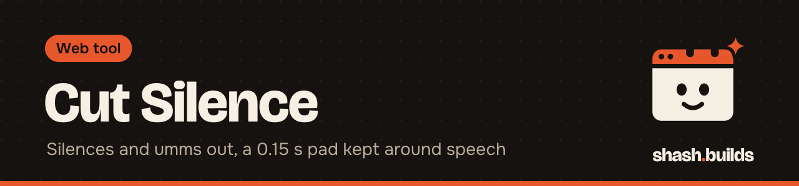
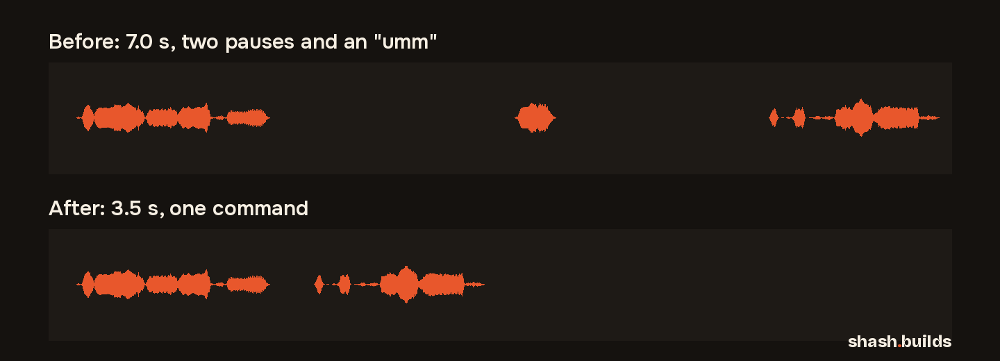

<p align="center"></p>

# Cut Silence

**Cuts the silences and the "umm"s out of a face recording or voice-over, keeping 0.15 s of room around every word.** One command, ffmpeg only, on your own computer.

<p align="center"></p>

## Install in 3 steps

1. Install ffmpeg (or run the [toolbox installer](../README.md#install-everything)).
2. Install Python 3.9 or newer. No Python packages are needed.
3. Run it: `python cut_silence.py face.mp4`

## Example

```bash
python cut_silence.py face.mp4 --words face.words.json
```

Windows (PowerShell), untested on Windows yet:

```powershell
python .\cut_silence.py .\face.mp4 --words .\face.words.json
```

`face.words.json` comes from [transcribe](../transcribe) (`python transcribe.py face.mp4`). Leave out `--words` to cut silences only.

| Option | What it does |
| --- | --- |
| `-o out.mp4` | output file (default `face_cut.mp4`); the original is never overwritten |
| `--pad 0.15` | seconds kept before and after speech |
| `--min-silence 0.4` | shortest pause that gets cut |
| `--threshold -35` | silence level in dB: `-30` for a noisy room, `-45` if quiet words get cut |
| `--words FILE` | word timings from transcribe: filler words get cut too |
| `--fillers "um,uh"` | which words count as fillers (default: um, umm, uh, er, erm, ah, hmm, mm) |
| `--dry-run` | print the cut list and the new length, write nothing |

It also writes `face_cut.mp4.cuts.json`: every part kept and removed, with times.

## Before and after

| Before | After |
| --- | --- |
| `face.mp4`, 7.0 s: "Today we build a website." (1.5 s pause) "Umm." (1.2 s pause) "It takes seven days." | `face_cut.mp4`, 3.5 s: "Today we build a website, it takes 7 days." (transcribed again to check) |

The test video is a test pattern with a synthetic flite voice, made with ffmpeg. No real person.

## What it's tested on

| Where | Command | Result |
| --- | --- | --- |
| Linux, ffmpeg 6.1, Python 3.13 | `python3 cut_silence.py face.mp4 --words face.words.json` | 7.0 s to 3.5 s, video and audio in sync |
| Linux, same | `python3 cut_silence.py face.mp4` | 7.0 s to 4.1 s (silences only) |
| Linux, same | `python3 cut_silence.py gaps.wav --dry-run` | works on audio-only files |
| Windows | the PowerShell command above | not tested yet |

## How it works

ffmpeg's `silencedetect` finds every pause; filler words come from the transcript's word timings. Cuts that touch, or that have no real word between them, are merged, then each cut is shrunk by the pad on both sides. The kept parts are joined with ffmpeg's `select` and `aselect` filters and re-encoded (H.264, CRF 18, AAC 192k).

Why not auto-editor? It's a fine tool, but ffmpeg alone keeps the install to one dependency and works the same on Windows, macOS and Linux.

## Use it as a Claude skill

`SKILL.md` next to this README tells Claude how to run the script, preview the cuts first, and chain it with transcribe.

## Licenses

| Dependency | License |
| --- | --- |
| [ffmpeg](https://ffmpeg.org/legal.html) (installed separately) | LGPL 2.1 or later; builds with libx264 are GPL 2 or later |
| Python standard library | PSF License |

This tool: MIT, like the rest of the repo.

## FAQ

**Does it cost anything?** No. It's free and MIT licensed.

**Will it cut my breaths?** Only if they're quieter than the threshold for longer than `--min-silence`. Raise `--min-silence` to keep more natural pauses.

**Do my captions still line up?** No, the timing changes. Run transcribe on the cut file to get new captions.

## Changelog

- **0.1.0** (2026-11-03): first release.

---

Made by [shash.builds](../../../README.md). Need a one-page website for your service business? [$400 flat, live in 7 days](../../../README.md#hire-me).
