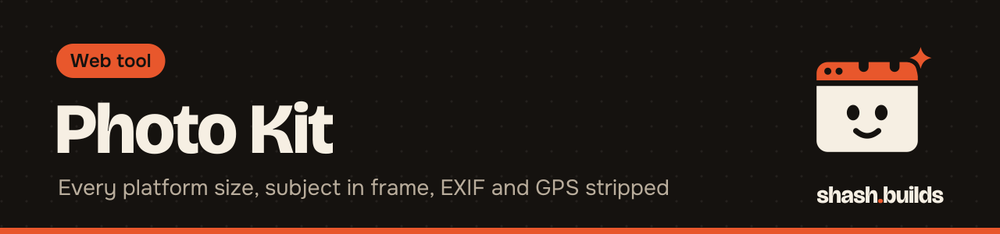
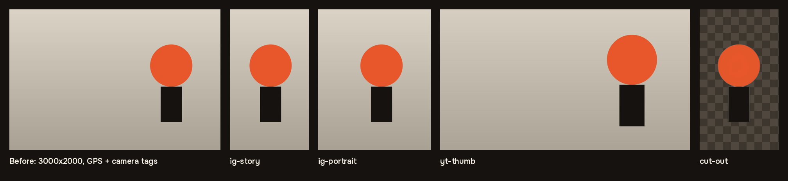

<p align="center"></p>

# Photo Kit

**One photo in; every platform size out, cropped around the subject, compressed, with EXIF and GPS location always stripped.** Optional background removal, all on your own computer.

<p align="center"></p>

## Install in 3 steps

1. Install Python 3.9 or newer (or run the [toolbox installer](../README.md#install-everything)).
2. `python -m pip install -r requirements.txt` (only `pillow` if you don't need background removal)
3. Run it: `python photo_kit.py photo.jpg`

## Example

```bash
python photo_kit.py photo.jpg --sizes all --remove-bg --out photo-kit
```

Windows (PowerShell), untested on Windows yet:

```powershell
python .\photo_kit.py .\photo.jpg --sizes all --remove-bg --out .\photo-kit
```

| Size | Pixels | Size | Pixels |
| --- | --- | --- | --- |
| `ig-portrait` | 1080x1350 | `linkedin-square` | 1200x1200 |
| `ig-story` | 1080x1920 | `yt-thumb` | 1280x720 |
| `ig-square` | 1080x1080 | `dribbble` | 1600x1200 |
| `linkedin` | 1200x627 | `og` | 1200x630 |

| Option | What it does |
| --- | --- |
| `--sizes all` | `all` or a comma list of the names above |
| `--remove-bg` | cut the subject out (rembg, local); also saves `NAME-cutout.png` |
| `--bg-color "#f6efe3"` | put the cut-out on a flat color instead of transparency |
| `--focus auto` | `auto` centers each crop on the subject; `center`; or `X,Y` from 0 to 1 |
| `--format auto` | `auto` (JPEG, or PNG when there's transparency), `jpg`, `png`, `webp` |
| `--quality 82` | JPEG and WebP quality |
| `--strip-only` | only remove metadata, keep the size |

Every run writes `photo-kit.json` in the output folder: each file, its size in bytes, and what metadata was removed.

## Privacy, always on

Phone photos carry EXIF data: the camera, the time, often the exact GPS location. Photo Kit applies the photo's rotation, then saves every output from a fresh copy of the pixels with no EXIF, no GPS, no ICC profile and no other metadata. There's no option to keep it.

## Before and after

| Before | After |
| --- | --- |
| `photo.jpg`, 3000x2000, 111 KB, 3 EXIF tags including GPS (28.6 N, 77.2 E) and a camera model, subject on the right | 8 JPEGs from 12 KB to 23 KB, each with 0 EXIF tags and the subject in frame; with `--remove-bg`, a transparent cut-out and PNG crops |

The test image is drawn with Pillow (shapes on a gradient, a planted GPS tag). No real person or place.

## What it's tested on

| Where | Command | Result |
| --- | --- | --- |
| Linux, Python 3.13, Pillow 12 | `python3 photo_kit.py photo.jpg` | 8 sizes in 1 s, metadata gone |
| Linux, same, rembg 2.0.86 | `python3 photo_kit.py photo.jpg --remove-bg --sizes ig-story,yt-thumb` | cut-out and 2 crops in 14 s, including the one-time model download |
| Windows | the PowerShell command above | not tested yet |

## How the crop finds the subject

Without background removal, it estimates the background color from the photo's border and centers on the 15% of pixels that look least like it (a face, a product, text). With a cut-out, it centers on the cut-out. If a crop still misses, pass `--focus X,Y`.

## Use it as a Claude skill

`SKILL.md` next to this README tells Claude which sizes to make, to check every crop, and to report what metadata was removed.

## Licenses

| Dependency | License |
| --- | --- |
| [Pillow](https://github.com/python-pillow/Pillow) | MIT-CMU (HPND) |
| [rembg](https://github.com/danielgatis/rembg) (optional) | MIT |
| U2-Net model used by rembg | Apache-2.0 |
| ONNX Runtime | MIT |
| NumPy, SciPy, scikit-image, pooch | BSD-3-Clause |
| PyMatting, jsonschema, tqdm | MIT (tqdm: MPL-2.0 and MIT) |

This tool: MIT, like the rest of the repo.

## FAQ

**Does it cost anything?** No. It's free and MIT licensed.

**Is my photo uploaded for background removal?** No. rembg runs the model on your computer; only the model is downloaded, once.

**Can I process a folder?** Yes: `python photo_kit.py photos/*.jpg --out kit` (in PowerShell, list the files or use `Get-ChildItem`).

## Changelog

- **0.1.0** (2026-11-03): first release.

---

Made by [shash.builds](../../../README.md). Need a one-page website for your service business? [$400 flat, live in 7 days](../../../README.md#hire-me).
