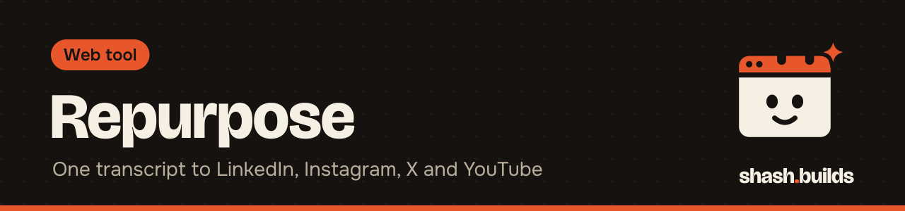

<p align="center"></p>

# Repurpose

**One video transcript in; a LinkedIn post, an Instagram caption with 3 hashtags, an X thread and a YouTube title, description and chapters out.** Human tone, no em dashes, every platform limit checked by a script. No API key.

## Install in 3 steps

1. Install Python 3.9 or newer. No packages needed.
2. Get a transcript with [transcribe](../transcribe) (the `.srt` has the timings chapters need).
3. Run `python repurpose.py prompt day-01.srt`

## Example

```bash
python repurpose.py prompt day-01.srt --topic "Day 1: a one-page site for a plumber"
python repurpose.py check day-01.repurpose.md
```

Windows (PowerShell), untested on Windows yet:

```powershell
python .\repurpose.py prompt .\day-01.srt --topic "Day 1: a one-page site for a plumber"
python .\repurpose.py check .\day-01.repurpose.md
```

Three ways to get the four pieces written:

| Where | How |
| --- | --- |
| Claude (skill) | Claude reads the prompt file, writes `day-01.repurpose.md`, runs `check` and fixes until it passes |
| Any chat model, no install | open `day-01.repurpose-prompt.md`, paste it into the chat, save the answer as `day-01.repurpose.md`, run `check` |
| Free local model | install [Ollama](https://ollama.com), then `python repurpose.py prompt day-01.srt --ollama llama3.1` drafts and checks in one go |

## What `check` looks for

- All four sections: `## LinkedIn`, `## Instagram`, `## X thread`, `## YouTube`
- No em dashes or en dashes, and none of the common stock phrases ("game-changer", "it's not just", "delve"...)
- LinkedIn: 3,000 characters at most, first line under 60 so it shows before "see more"
- Instagram: 2,200 characters at most, exactly 3 hashtags, alone on the last line
- X: every post under 280 characters, numbered `1/ 2/ 3/`
- YouTube: a title of 100 characters at most, no `<` or `>`, chapters starting at 00:00, at least 3, each at least 10 seconds apart

## Before and after

Before: the transcript of an 11.5 second test voice (synthetic, no real person):

```text
[00:00] Day one. Today I built a one page website for a local plumber in 20 minutes. Here is
the site. It has a big call button, real reviews and the service area.
[00:09] Tomorrow I send it to the owner.
```

After: [`example.repurpose.md`](example.repurpose.md), which passes `check`. A version with an em dash, "game-changer", 4 hashtags and chapters 5 seconds apart fails with:

```text
- 1 em or en dash(es): rewrite with a comma, colon or full stop
- stock phrase "game-changer": say it plainly
- stock phrase "it's not just": say it plainly
- LinkedIn: first line is 82 characters; keep it under 60 so it shows before 'see more'
- Instagram: 4 hashtags, need exactly 3
- YouTube: chapters at 00:10 and 00:15 are under 10 seconds apart
```

## What it's tested on

| Where | Command | Result |
| --- | --- | --- |
| Linux, Python 3.13 | `python3 repurpose.py prompt voice.srt` | prompt with [mm:ss] marks |
| Linux, same | `python3 repurpose.py check good.md` / `bad.md` | ok / 6 fixes, exit 1 |
| Linux, no Ollama running | `python3 repurpose.py prompt voice.txt --ollama llama3.1` | says Ollama isn't reachable, keeps the prompt file |
| Windows | the PowerShell commands above | not tested yet |

Platform limits change: check them again if a platform announces new ones.

## Use it as a Claude skill

`SKILL.md` next to this README tells Claude to build the prompt, write the four pieces itself, run `check` and fix until it passes. If the shash.builds [Humanizer](../../../skills/humanizer) skill is installed, Claude also runs each piece through it.

## Licenses

| Dependency | License |
| --- | --- |
| Python standard library | PSF License |
| [Ollama](https://github.com/ollama/ollama) (optional, installed separately) | MIT; each model has its own license |

This tool: MIT, like the rest of the repo.

## FAQ

**Does it cost anything?** No. It's free and MIT licensed, and it never calls a paid API.

**Does it post for me?** No. It writes and checks; you post.

**Can it make up a result I didn't mention?** The prompt forbids facts that aren't in the transcript. Read the pieces before posting anyway.

## Changelog

- **0.1.0** (2026-11-03): first release.

---

Made by [shash.builds](../../../README.md). Need a one-page website for your service business? [$400 flat, live in 7 days](../../../README.md#hire-me).
