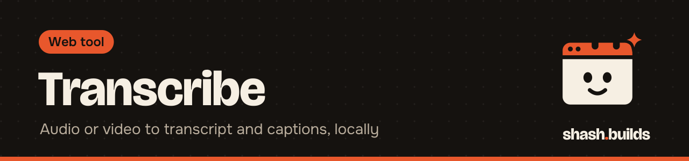

<p align="center"></p>

# Transcribe

**Audio or video in, transcript and captions out, on your own computer.** Local Whisper (faster-whisper), English, Hindi and Hinglish. No API key, nothing uploaded.

It's the command-line front end of the [Transcriber skill](../../../skills/transcriber): the same engine, with reel-sized captions (42 characters a line), a choice of model by name, and a flat word list that [cut-silence](../cut-silence) and video-build read.

## Install in 3 steps

1. Install Python 3.9 or newer and ffmpeg (or run the [toolbox installer](../README.md#install-everything), which does both).
2. `python -m pip install -r requirements.txt`
3. Run it: `python transcribe.py reel.mp4`

The first run downloads the model once into the Hugging Face cache: `small` is about 470 MB, `medium` about 1.5 GB.

## Example

```bash
python transcribe.py reel.mp4 --model small --language en
```

Windows (PowerShell), untested on Windows yet:

```powershell
python .\transcribe.py .\reel.mp4 --model small --language en
```

| Option | What it does |
| --- | --- |
| `--model small` | `small` (default, fast) or `medium` (more accurate, better for Hindi). `base` and `large-v3` also work. |
| `--language auto` | `auto`, `en`, `hi`, or any Whisper language code |
| `--hinglish` | Hindi or Hinglish written in Roman letters, English words kept in English |
| `--prompt "shash.builds"` | names and words to expect, so they're spelled right |
| `--out-dir out` | where the files go (default: next to the input) |
| `--model-dir DIR` | a local faster-whisper model folder, for offline use |
| `--max-chars 42` | longest caption line |

## Before and after

Before: `demo.wav`, a 7.8 second synthetic voice made with ffmpeg's flite voice (no real person).

After (`--model small --prompt "shash.builds"`, tested on Linux):

```text
demo.txt
  Hello and welcome to shash.builds.
  Today we build a one-page website for a
  local plumber.
  It takes about seven days.

demo.srt
  1
  00:00:00,000 --> 00:00:02,280
  Hello and welcome to shash.builds.
  ...

demo.words.json
  {"language": "en", "duration": 7.805, "model": "small",
   "words": [{"start": 0.0, "end": 0.4, "word": "Hello", "probability": 0.91}, ...]}

demo.json   the engine's segments, same format as the Transcriber skill
```

Make the same test file yourself (needs an ffmpeg build with flite, which most Linux builds have):

```bash
ffmpeg -f lavfi -i "flite=text='Hello and welcome to shash dot builds.':voice=slt" demo.wav
```

## What it's tested on

| Where | Command | Result |
| --- | --- | --- |
| Linux, Python 3.13, faster-whisper 1.2.1 | `python3 transcribe.py demo.wav --model small` | works, about 10 s on CPU |
| Linux, same, unzipped skill zip (engine bundled) | `python3 transcribe/transcribe.py demo.wav` | works |
| Linux, same | `python3 transcribe.py demo.wav --model medium --language en` | works |
| Linux, same | `python3 transcribe.py demo.wav --hinglish` | runs; needs a real Hindi recording to judge quality |
| Windows | the PowerShell command above | not tested yet |

Known issue, handled: PyAV 19 breaks faster-whisper 1.2's built-in decoder. The engine reads audio with ffmpeg when it's installed, and `requirements.txt` pins `av<19` for the fallback.

The `small` model is fetched from the verified shash.builds packages once they're published, otherwise from Hugging Face. `medium` and `large-v3` always come from Hugging Face.

## Use it as a Claude skill

`SKILL.md` next to this README tells Claude how to run the script. Install the zip from the release (it bundles the engine), or use the [Transcriber skill](../../../skills/transcriber) in Claude Code.

## Licenses

| Dependency | License |
| --- | --- |
| [faster-whisper](https://github.com/SYSTRAN/faster-whisper) | MIT |
| [CTranslate2](https://github.com/OpenNMT/CTranslate2) | MIT |
| Whisper models by OpenAI | MIT |
| [PyAV](https://github.com/PyAV-Org/PyAV) | BSD-3-Clause |
| NumPy | BSD-3-Clause |
| Hugging Face Hub client, tokenizers | Apache-2.0 |
| ONNX Runtime (voice activity filter) | MIT |
| [ffmpeg](https://ffmpeg.org/legal.html) (optional, installed separately) | LGPL 2.1 or later (some builds GPL) |

This tool: MIT, like the rest of the repo.

## FAQ

**Does it cost anything?** No. It's free and MIT licensed, and it never calls a paid API.

**Does my audio leave my computer?** No. Only the model is downloaded, once.

**Do I need a GPU?** No. It uses an NVIDIA GPU when CUDA is set up, otherwise the CPU.

## Changelog

- **0.1.0** (2026-11-03): first release.

---

Made by [shash.builds](../../../README.md). Need a one-page website for your service business? [$400 flat, live in 7 days](../../../README.md#hire-me).
