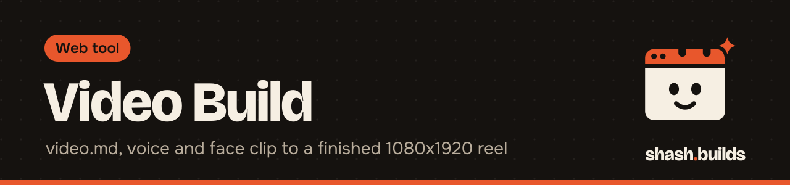
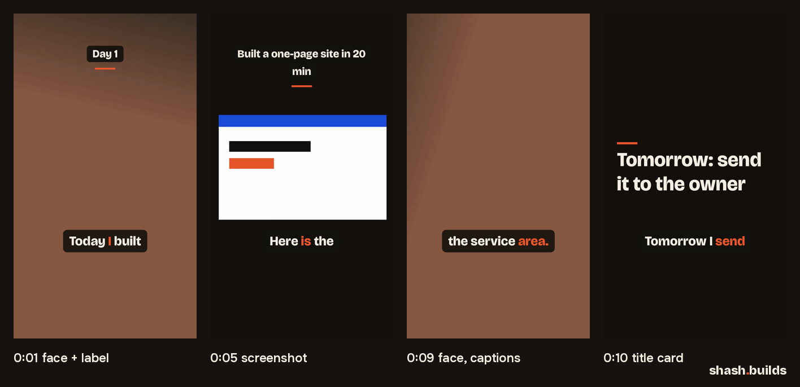

<p align="center"></p>

# Video Build

**A day's `video.md`, a voice track, a face clip and screenshots in; a finished 1080x1920 reel out.** Shots cut to a timeline, word-by-word brand captions, on-screen text, an optional music bed, loudness at -14 LUFS. One command, on your own computer.

<p align="center"></p>

## Install in 3 steps

1. Install ffmpeg and Python 3.9 or newer (or run the [toolbox installer](../README.md#install-everything)).
2. `python -m pip install -r requirements.txt`
3. Write a `video.md` (below) and run `python video_build.py video.md`

## The render command

```bash
python video_build.py video.md -o day-01.mp4 --stinger tab.mp4
```

Windows (PowerShell), untested on Windows yet:

```powershell
python .\video_build.py .\video.md -o .\day-01.mp4 --stinger .\tab.mp4
```

| Option | What it does |
| --- | --- |
| `-o day-01.mp4` | output file (default: `video.mp4` next to `video.md`) |
| `--dry-run` | print every shot with its start and end, render nothing |
| `--words voice.words.json` | word timings from [transcribe](../transcribe); default: transcribe the voice now |
| `--model medium` | transcribe model when there's no `--words` (`small` by default; `medium` for Hindi) |
| `--stinger FILE` | a short clip added at the end, like the Tab stinger |
| `--music-db -20` | music level under the voice |
| `--lufs -14` | final loudness |
| `--no-captions` | skip captions (also `burn: no` in `video.md`) |

## video.md

Paths are relative to the `video.md` folder.

```markdown
---
date: 2026-11-04
day: 1
title: Day 1, short title
voice: voice.m4a        # the voice track (optional if the face clip has audio)
face: face.mp4          # the face clip, in sync with the voice from 0:00 (optional)
music: none             # or: music/bed.mp3 | Track by Artist, license
---
## Script
(plain text; captions come from transcribing the voice, not from this)

## Shots
| at | shot | on-screen text |
|---|---|---|
| 0:00 | face | Day 1 |
| 0:04 | screen: assets/site.png | Built a one-page site in 20 min |
| 0:10 | title | Tomorrow: send it to the owner |

## Captions
burn: yes
style: brand
```

Shots are `face` (the face clip at the same moment), `screen: FILE` (an image gets a slow push-in; a video plays fitted on the brand background) or `title` (the on-screen text large on the brand background). Each shot runs until the next one starts; the video is as long as the voice.

## Before and after

| Before | After |
| --- | --- |
| `video.md` with 4 shots, an 11.5 s voice, a face clip, one screenshot, a music bed, a 1.5 s stinger | `video.mp4`: 1080x1920, 30 fps, 13.0 s, -14.1 LUFS integrated, captions burned in, `video.mp4.credits.txt` with the music credit |

The test day uses a synthetic flite voice, a gradient standing in for the face clip, a drawn screenshot and a generated sine-wave bed. No real person, no third-party media.

## What it's tested on

| Where | Command | Result |
| --- | --- | --- |
| Linux, ffmpeg 6.1, Python 3.13, Pillow 12 | `python3 video_build.py video.md --stinger sting.mp4` | 13.0 s video in 28 s on 4 CPU cores, -14.1 LUFS |
| Linux, same | `python3 video_build.py video.md --dry-run` | prints the shot plan |
| Windows | the PowerShell command above | not tested yet |

## How it works

1. Reads `video.md`, checks every file it names, and works out each shot's start and end.
2. Transcribes the voice with the transcribe tool (or reads `--words`).
3. Cuts each shot to exactly its length at 1080x1920 and 30 fps with ffmpeg.
4. Draws the captions and on-screen text with Pillow in the brand fonts (Bricolage Grotesque 800), one image per change, and lays them over the shots as one timed track. Drawing them this way keeps the fonts and colors identical on every OS.
5. Mixes the voice with the music bed (looped, faded out), normalizes to -14 LUFS with a -1.5 dBTP peak, and encodes H.264 and AAC.

## Use it as a Claude skill

`SKILL.md` next to this README tells Claude how to write a `video.md` with you, preview the plan, render and check the result. The release zip includes the transcribe tool.

## Licenses

| Dependency | License |
| --- | --- |
| [ffmpeg](https://ffmpeg.org/legal.html) (installed separately) | LGPL 2.1 or later; builds with libx264 are GPL 2 or later |
| [Pillow](https://github.com/python-pillow/Pillow) | MIT-CMU (HPND) |
| Bricolage Grotesque, Onest fonts (downloaded on first run) | SIL Open Font License 1.1 |
| transcribe tool and its dependencies | MIT, BSD-3-Clause, Apache-2.0 (see [its README](../transcribe/README.md#licenses)) |

This tool: MIT, like the rest of the repo. Music you add keeps its own license: use royalty-free tracks and put the credit in the post.

## FAQ

**Does it cost anything?** No. It's free and MIT licensed.

**My face clip and voice are separate recordings. Will they sync?** The face clip plays from the same moment as the voice, so record them together or line them up first. If the face clip has its own sound and there's no `voice:`, that sound is used.

**A caption has a misheard word.** Edit the word in `voice.words.json` and render again with `--words voice.words.json`.

## Changelog

- **0.1.0** (2026-11-03): first release.

---

Made by [shash.builds](../../../README.md). Need a one-page website for your service business? [$400 flat, live in 7 days](../../../README.md#hire-me).
